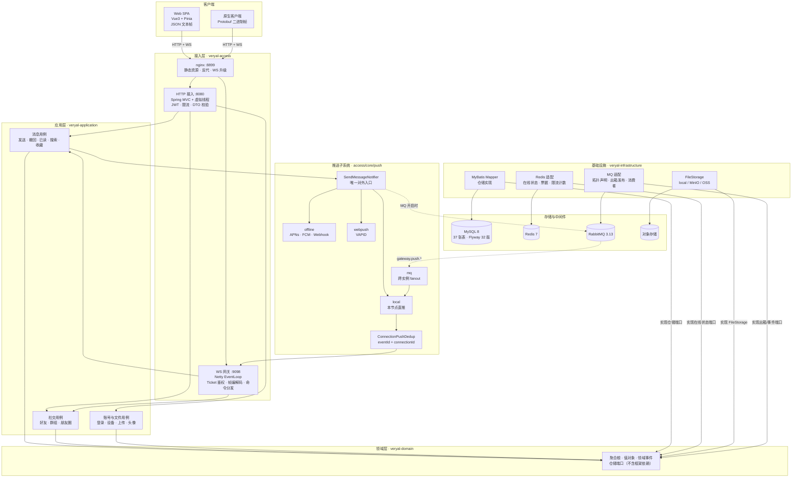
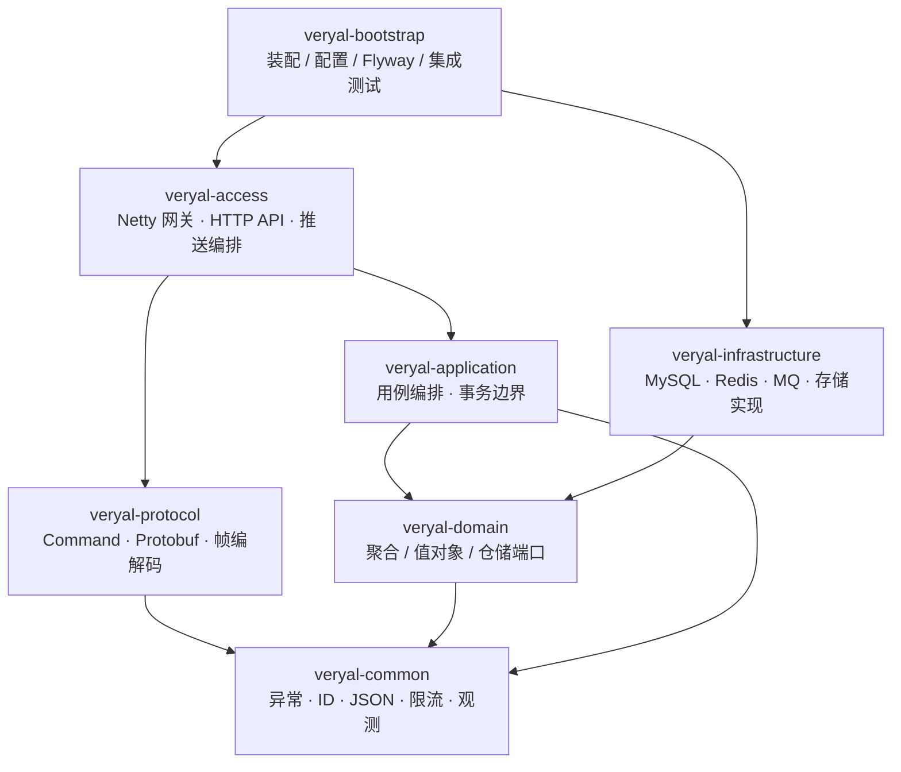
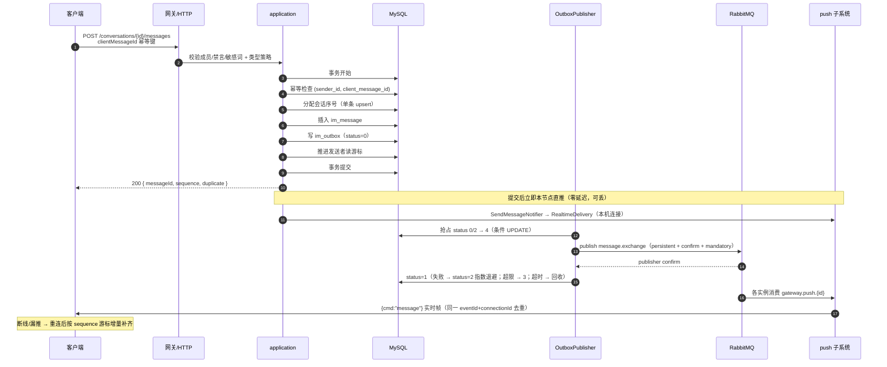

# VERYAL · 即时通讯服务端

<p align="left">
  
  
  
  
  
  
  
</p>

面向个人用户的即时通讯服务端：账号、好友、单聊、群聊、朋友圈、富媒体、多端同步、离线推送、运营后台。

这个仓库不追求「跑通通信流程」，而是把 IM 里最容易出事故的地方按可上线的标准做完整：**消息不丢、不重复、不乱序、多端同步、大群扇出、文件越权、单点故障后的自愈**。默认 `dev` profile 用 H2 + 内存实现，克隆下来 `mvn package` 就能起。

> 客户端 + 服务端的整体架构图在仓库根目录 [`../README.md`](../README.md)；本文只讲服务端。

## 功能一览

| 域 | 能力 |
|---|---|
| 账号 | 注册登录、JWT + Refresh 轮换、多设备、资料与隐私设置、拉黑、注销 |
| 好友 | 申请 / 同意 / 拒绝、备注、分组、黑名单、好友事件实时通知 |
| 单聊 | 文本 / 图片 / 音频 / 视频 / 文件 / 位置 / 卡片、引用、转发、撤回（2 分钟）、已读回执、会话置顶/免打扰/草稿 |
| 群聊 | 建群、邀请、踢人、退群、转让群主、管理员、全员/单人禁言、公告、群成员上限 1000 |
| 朋友圈 | 发布图文、可见范围四档、点赞评论、互动通知、按人屏蔽 |
| 富媒体 | 普通上传 32MB / 分片 256MB 断点续传、图片压缩、缩略图、SVG 按附件下载、越权校验 |
| 多端同步 | 会话内 `sequence` 单调递增、多端各自读游标、重连按游标增量补齐 |
| 实时 | WebSocket（Web 走 JSON、原生走 Protobuf）、本节点直推 + MQ 跨实例广播 |
| 离线 | APNs、FCM、Webhook 网关、浏览器 Web Push（VAPID） |
| 运营 | 独立管理员表 / Token / 权限 scope、用户封禁、举报处理、敏感词、审计日志、TOTP MFA |
| 工程 | 限流（令牌桶 + 滑动窗口）、雪花 ID、Outbox、DLX、Flyway 迁移、健康检查、集成测试 |

## 目录

- [1. 架构总览](#1-架构总览) · [1.1 全模块通信架构](#11-全模块通信架构) · [1.2 通信协议](#12-通信协议) · [1.3 部署拓扑](#13-部署拓扑) · [1.4 端口与进程](#14-端口与进程) · [1.5 代码模块与依赖方向](#15-代码模块与依赖方向) · [1.6 接入层内部分包](#16-接入层内部分包) · [1.7 仓库结构](#17-仓库结构)
- [2. 一条消息的完整旅程](#2-一条消息的完整旅程)
- [3. 实时推送子系统](#3-实时推送子系统)
- [4. 数据模型](#4-数据模型)
- [5. 部署](#5-部署) · [5.1 本地零依赖](#51-本地零依赖) · [5.2 Docker Compose](#52-docker-compose) · [5.3 裸机 systemd](#53-裸机-systemd当前线上形态) · [5.4 中间件容器](#54-中间件容器) · [5.5 容量与上限](#55-容量与上限)
- [6. 关键设计](#6-关键设计) · [7. 配置](#7-配置) · [8. 测试](#8-测试) · [9. 可扩展点](#9-可扩展点) · [10. 已知限制](#10-已知限制) · [11. 运维速查](#11-运维速查) · [12. 文档](#12-文档) · [13. 路线](#13-路线)

---

## 1. 架构总览

### 1.1 全模块通信架构

一张图看完「客户端怎么进来、请求经过哪些模块、消息最终落到哪里」：



读图要点：

- **层间箭头是依赖方向，不是调用方向**：`infrastructure` 指回 `domain`（实现仓储端口），所以领域层能保持「零框架依赖」还能被替换实现。
- **只有一条写路径**：HTTP 发消息和 WS 发消息最终都进同一批 `application` 用例，所以校验、幂等、序号分配只有一份实现。
- **`access` 不依赖 `infrastructure`**：网关/Controller 只认 `application` 的用例与 `domain` 的端口，具体是 MySQL 还是缓存由 `bootstrap` 装配。
- **实时推送是旁路**：消息先落库提交，再由 `SendMessageNotifier` 分两条链路推（本机直推 + MQ 广播），推送失败不影响消息本身。

### 1.2 通信协议

两条通道共用一套 `Command` 指令码，Web 端用 JSON 文本帧，原生客户端用 16 字节帧头 + Protobuf：

| 指令 | 码 | 方向 | 说明 |
|---|---|---|---|
| `HEARTBEAT` / `HEARTBEAT_ACK` | `0x0001` / `0x0002` | ↔ | 心跳，90 秒无流量由 IdleStateHandler 断开 |
| `LOGIN` / `LOGIN_RESPONSE` | `0x0010` / `0x0011` | ↔ | 原生客户端登录（Web 走 HTTP 换 ticket） |
| `LOGOUT` | `0x0012` | → | 主动登出 |
| `SEND_MESSAGE` / `SERVER_ACK` | `0x0100` / `0x0101` | ↔ | 发消息与服务器确认（带 `clientMessageId`） |
| `MESSAGE_NOTIFY` | `0x0102` | ← | 新消息推送 |
| `MESSAGE_RECALL` | `0x0103` | ← | 撤回推送 |
| `DELIVERY_ACK` / `READ_ACK` / `READ_NOTIFY` | `0x0110` / `0x0111` / `0x0112` | ↔ | 投递回执、已读上报与已读推送 |
| `FRIEND_NOTIFY` | `0x0120` | ← | 好友申请 / 通过 |
| `MOMENT_NOTIFY` | `0x0130` | ← | 朋友圈互动 |
| `ERROR` | `0x01FF` | ← | 错误帧（带 `ErrorCode`） |

Web 端的 JSON 帧形如 `{"cmd":"message","data":{...}}`，只有 `ping` / `ack` 是客户端上行；已读与撤回目前靠 HTTP 轮询（见[已知限制](#10-已知限制)）。二进制帧是**固定 16 字节头 + 变长 Protobuf**，大端序：

```text
┌────────────┬─────────┬────────┬───────────┬────────────┬──────────────┬─────────────┐
│ Magic (4)  │ Ver (1) │Flags(1)│ Command(2)│ Sequence(4)│ BodyLength(4)│ Payload (N) │
│  "VRYL"    │   1     │ 0x01=PB│  0x0100…  │  帧序号     │  最大 1MB     │  Protobuf   │
└────────────┴─────────┴────────┴───────────┴────────────┴──────────────┴─────────────┘
```

`VeryalFrameDecoder` 负责拆包/粘包与非法帧（魔数错、长度超限、版本不符直接断开），`Envelope` 负责 `command + payload` 的编解码；WebSocket 传输把二进制帧当二进制消息发，文本连接上的二进制帧会被丢弃（所以 Web 端只用 JSON 帧）。

### 1.3 部署拓扑

```text
                     浏览器（Vue3 SPA） / 原生客户端（Protobuf）
                                     │
                                     │ HTTP + WebSocket :8899
                     ┌───────────────▼────────────────────┐
                     │ nginx 1.24（宿主机 systemd）        │
                     │  /                 → /home/ubuntu/veryal/web
                     │  /api/             → 127.0.0.1:8080
                     │  /ws               → 127.0.0.1:9098（Upgrade）
                     │  /actuator/health  → 127.0.0.1:8080
                     │  /actuator/*       → deny
                     └──────┬────────────────────────┬────┘
                            │                        │
        ┌───────────────────▼─────────┐   ┌──────────▼──────────────────┐
        │ HTTP 接入  127.0.0.1:8080   │   │ WS 网关  127.0.0.1:9098     │
        │ Spring MVC + 虚拟线程        │   │ Netty EventLoop（不阻塞）    │
        │ REST / Swagger / Actuator   │   │ JSON 文本帧 + Protobuf 二进制 │
        └───┬─────────┬─────────┬─────┘   └──────────┬──────────────────┘
            │         │         │                    │
   ┌────────▼──┐ ┌────▼─────┐ ┌─▼──────────┐  ┌──────▼───────────────────┐
   │ MySQL 8   │ │ Redis 7  │ │ RabbitMQ   │  │ LocalConnectionRegistry  │
   │ :13306    │ │ :16379   │ │ :5672     │  │ 本节点连接 / 去重 / 慢连接 │
   │ 37 张表   │ │ 在线+票据│ │ 事件+DLX  │  └──────────────────────────┘
   └───────────┘ └──────────┘ └────────────┘
```

单机是默认形态；把 `veryal.mq.enabled` 与 `veryal.redis.enabled` 打开就是多实例形态——每个实例只推自己持有的连接，跨实例靠 fanout 广播 + 客户端游标兜底。

**对外只需要 `8899` 一个端口。** HTTP（`/api/`）、实时长连接（`/ws`）、前端静态资源和健康探针都从同一个站点进出，业务进程的 `8080`/`9098` 只绑回环。所以既不建议也不需要在防火墙上开 8080/9098：

- `/ws` 那段必须带 `Upgrade $http_upgrade` / `Connection "upgrade"` 两头，否则 nginx 会把长连接当普通 HTTP 请求转发，握手直接失败；
- `proxy_read_timeout` 要大于心跳周期（现在是 3600s vs 90s 心跳），否则空闲连接会被 nginx 先掐断；
- 要上 HTTPS 只改 nginx：给 `8899` 加证书并再监听 `443`，前端会自动按 `location.protocol` 选 `ws://` / `wss://`，后端一行不用改。

### 1.4 端口与进程

| 组件 | 监听 | 对外 | 说明 |
|---|---|---|---|
| nginx | `:8899` | 是 | 唯一对外入口，静态资源 + 反代 + WebSocket 升级 |
| Spring Boot HTTP | `127.0.0.1:8080` | 否 | `/api/v1/**`、`/actuator/health`、Swagger |
| Netty WS 网关 | `127.0.0.1:9098` | 否（经 nginx） | `/ws?format=json` / `/ws?format=protobuf` |
| MySQL 8.0.30 | `127.0.0.1:13306` | 否 | 容器 `veryal-mysql` |
| Redis 7.4 | `127.0.0.1:16379` | 否 | 容器 `veryal-redis` |
| RabbitMQ 3.13 | `127.0.0.1:5672` / `15672` | 否 | 容器 `veryal-rabbitmq` |
| Prometheus 指标 | `127.0.0.1:8080/actuator/prometheus` | 否 | 走隧道抓取 |

### 1.5 代码模块与依赖方向



依赖只允许向下，且由 Maven 模块边界物理隔离（不是口头约定）：`domain` 引不到 Spring/Netty/MyBatis，`application` 引不到 Mapper，`infrastructure` 引不到 application。`access` 不依赖 `infrastructure`，两者的装配只在 `bootstrap` 发生。

| 模块 | 规模 | 职责 | 不允许出现 |
|---|---|---|---|
| `veryal-common` | 30 类 | 统一异常与错误码、雪花 ID、JSON、限流算法、日志/追踪上下文、内容审核 DFA | Spring Web、数据库 |
| `veryal-protocol` | 9 类 | `Command` 枚举、Protobuf 报文、16 字节帧头编解码、拆包粘包处理 | 业务逻辑 |
| `veryal-domain` | 128 类 / 18 个业务包 | 聚合根、值对象、领域规则、仓储端口、领域事件 | Spring、Netty、MyBatis、Redis |
| `veryal-application` | 106 类 | 用例编排、事务边界、消息类型策略、跨聚合一致性 | SQL、HTTP、Netty 类型 |
| `veryal-infrastructure` | 135 类 | MyBatis Mapper/PO/仓储实现、Redis 在线状态、RabbitMQ 拓扑与监听、存储策略 | application 层依赖 |
| `veryal-access` | 206 类 | Netty 连接与鉴权、命令分发、HTTP Controller/DTO、推送编排、限流与 TLS | 直接操作 Mapper |
| `veryal-bootstrap` | 2 类 | 启动类、全局 Bean 装配、Flyway 迁移脚本 | 业务逻辑 |

### 1.6 接入层内部分包

```text
access/
├── websocket/            Netty 服务端、握手、帧编解码、连接生命周期
├── core/
│   ├── Connection       连接状态机（CONNECTED → AUTHENTICATING → ONLINE → CLOSED）
│   ├── LocalConnectionRegistry  本节点连接表 + 单用户多端
│   ├── handler/         命令处理器（认证、心跳、发送、已读、撤回、登出）
│   │   └── business/    发送 / 已读 / 投递 ACK / 撤回 / 登出
│   ├── protocol/        帧 ↔ Command 映射、错误帧
│   ├── limit/           连接数、单 IP 连接数、帧速率
│   ├── tls/             可选 TLS（PEM + 密码）
│   ├── metrics/         连接数 / 帧数指标
│   └── push/            推送子系统（见第 3 节）
└── http/
    ├── controller/      33 个 REST Controller（用户 / 会话 / 消息 / 群 / 朋友圈 / 运营）
    ├── dto/             93 个请求响应模型（record + Schema 注解）
    ├── security/        JWT 过滤器、当前用户解析、群权限切面、运营 Scope
    ├── realtime/        HTTP 侧向 WS 推送的桥（SendMessageNotifier 入口）
    └── support/         统一响应、分页、ID 序列化（long → string 防 JS 精度丢失）
```

### 1.7 仓库结构

```text
veryaI-backend/
├── pom.xml                     聚合 POM（8 个模块，Java 21）
├── veryal-common/              异常 · 雪花 ID · JSON · 限流算法 · 日志上下文 · 敏感词 DFA
├── veryal-protocol/            Command · Protobuf · 16 字节帧头编解码
├── veryal-domain/              聚合根 · 值对象 · 仓储端口 · 领域事件
├── veryal-application/         用例编排 · 事务边界 · 消息类型策略
├── veryal-infrastructure/      MyBatis · Redis · RabbitMQ · 存储实现
├── veryal-access/              Netty 网关 · HTTP API · 推送编排
├── veryal-bootstrap/           启动类 · Bean 装配 · Flyway 迁移 · 集成测试
├── config/                     .env 模板 · 配置渲染 · systemd 启动入口
├── deploy/docker/              compose · Dockerfile
├── bin/                        线上运维脚本（启停 / 健康 / 备份）
└── docs/                       架构、前端、进度文档
```

本地只需要跑 `veryal-bootstrap` 的启动类；所有装配发生在 `bootstrap`，其余模块保持「可编译、可单测、互不认识」。

---

## 2. 一条消息的完整旅程



关键点：

- **序号只信服务端**：会话内自增，客户端不做时间排序；跨端看到的顺序一致。
- **幂等**：`(sender_id, client_message_id)` 唯一约束，重复提交返回同一条消息与相同序号（`duplicate=true`）。
- **事务内只做持久化**，推送在提交后发生；推送失败不影响消息可靠性，客户端靠游标补齐。
- **单聊会话 ID 确定性生成**（`p_{小id}_{大id}`），一对用户只可能有一个会话。
- **撤回**：仅发送者本人、2 分钟内；保留行与序号，正文清空并广播 `MESSAGE_RECALL`。

---

## 3. 实时推送子系统

推送是这个仓库里唯一「有两条并行链路」的地方，所以按职责拆成了子包，避免单机直推与 MQ 下发混在一起：

```text
access/core/push/
├── SendMessageNotifier.java      发送后通知入口（HTTP 与 WS 共用，唯一对外入口）
├── RealtimeFanoutExecutor.java   有界线程池扇出（不占用发送线程，满了就丢）
├── ConnectionPushDedup.java      eventId + connectionId 连接级去重（两条链路共享）
│
├── local/                        本节点直推（"立即送达"优化）
│   ├── RealtimeDelivery          单机直投：私聊用接收者快照，群聊按成员分页拉取
│   ├── LocalGatewayPush          按 connectionId 推送（MQ 路由模式消费端调用）
│   ├── MessageFrame ←──┐        一条消息对单个连接的帧（不可变记录）
│   ├── MessageFrameWriter ┘     写连接：慢连接跳过、去重、文本发 JSON/原生发 PB
│   ├── LocalFriendPush           好友事件本节点推送
│   ├── LocalMomentPush           朋友圈互动本节点推送
│   ├── LocalReadReceiptPush      已读回执本节点推送
│   ├── LocalMessageRecallPush    撤回本节点推送
│   ├── LocalRealtimeSession      踢下线 / 会话关闭
│   └── Local*Notifier ×4          MQ 关闭时的直推入口（显式类，不走 lambda）
│
├── mq/                           MQ 开启时由广播消费者推送
│   └── Mq*Notifier ×4            本机入口空实现，真正推送在消费者侧
│
├── offline/                      离线通道（连不上才用）
│   ├── ApnsOfflinePushProvider   APNs HTTP/2 + ES256 JWT
│   ├── FcmOfflinePushProvider    FCM HTTP v1（Service Account OAuth2）
│   ├── FcmAccessTokenProvider
│   ├── WebhookOfflinePushProvider 通用厂商网关（华为/小米/聚合）
│   └── NoopOfflinePushProvider   未配置时只记日志
│
└── webpush/                      浏览器 Web Push
    ├── VapidKeyProvider          显式配置 → key-file → 自动生成并持久化
    └── WebPushSenderImpl          RFC 8291 加密 + RFC 8292 VAPID 签名
```

> `MessageFrame` / `MessageFrameWriter` 是这次重构的收敛点：本节点直推与 MQ 网关下发原先各写了一遍「可写判断 + 去重 + JSON/Protobuf 分支」，现在只有一份实现。

### 3.1 双链路与去重

```text
                        ┌──────────────────────────┐
   消息已提交 ────────▶ │ SendMessageNotifier      │
                        └───────┬──────────┬───────┘
                                │          │
                本节点直推（快，可丢）      出箱事件（可靠，可慢）
                                │          │
                    RealtimeDelivery   im_outbox → RabbitMQ
                                │          │
                                │     各实例 gateway.push.{id}
                                │          │
                                │      LocalGatewayPush
                                └────┬─────┘
                                     ▼
                          MessageFrameWriter
                    （ConnectionPushDedup：eventId+connectionId）
                                     ▼
                              客户端只收到一次
```

- 单机模式（`veryal.mq.enabled=false`）：只有左侧链路，`Local*Notifier` 直接调用 `Local*Push`。
- 多实例模式：两条链路都开，靠连接级去重合并；广播失败只记日志，不阻塞发送。

### 3.2 MQ 拓扑

```text
                       ┌────────────────────────┐
  im_outbox(status=0)  │  veryal.message.exchange│  topic, durable
        │              └───┬────────┬────────┬───┘
        │                  │        │        │
        │     message.created   read.receipt  message.recall
        │                  │        │        │
        ▼                  ▼        ▼        ▼
 ┌──────────────┐  ┌───────────────┐ ┌──────────────────┐
 │ delivery-queue│  │ per-instance  │ │ per-instance     │
 │ 全局单队列    │  │ gateway-push  │ │ read-receipt /   │
 │ (消费者组)    │  │ friend-event  │ │ message-recall / │
 └──────┬───────┘  │ moment-event  │ │ gateway-push     │
        │          └───────┬───────┘ └────────┬─────────┘
        │                  │ x-dead-letter-exchange
        ▼                  ▼                  ▼
  重试队列(TTL 5s)   veryal.dlx.exchange → veryal-dead-letter-queue
        └── 超过次数 ─────────┘
```

- 每实例队列名带随机实例后缀（`gateway-1-fa1c8471`），非持久 + auto-delete，实例下线自动清理。
- 所有每实例队列都挂了 **DLX**：消费失败 `basicNack(requeue=false)` 的消息进死信队列，而不是被静默丢弃。
- `veryal.push.exchange` 是 fanout 广播总线，每实例一条独占队列，只用于跨节点「推给本机连接」。

### 3.3 Outbox 状态机与可靠性

```text
   ┌─────────┐  claim(条件 UPDATE)   ┌────────────┐  confirm  ┌───────────┐
   │ 0 待发  │ ────────────────────▶ │ 4 发布中    │ ────────▶ │ 1 已发布  │
   └────┬────┘                       └─────┬──────┘           └───────────┘
        │  ▲                               │ 失败 / 超时回收
        │  │ markRetry(指数退避)            ▼
        │  └────────────── 2 待重试 ◀─── (retry_count < max)
        │                        │
        └── recoverStale ────────┘ retry_count ≥ max
                                 ▼
                            ┌───────────┐
                            │ 3 失败    │（保留现场，人工介入/重放）
                            └───────────┘
```

可靠性清单（每条都有对应实现）：

1. **不丢**：事件与消息同事务写 `im_outbox`；发布用持久化消息 + publisher confirm。
2. **不重**：`event_id` 唯一索引；抢占式 `status: 0/2 → 4` 的条件 UPDATE 保证多实例只有一个发布者。
3. **可重试**：失败进入 `status=2` 并按指数退避设置 `next_retry_at`，选单条件为 `status IN (0,2) AND next_retry_at <= now`。
4. **路由失败可见**：`mandatory=true` + 检查 `correlation.getReturned()`，未路由到任何队列的消息不再被当成发布成功。
5. **宕机自愈**：`PUBLISHING` 超过 stale 阈值自动回收为 `status=2`。
6. **消费失败可查**：每实例队列配 DLX，失败消息落 `veryal-dead-letter-queue`。
7. **漏推兜底**：客户端重连后按 `sequence` 游标增量补齐，实时推送永远只是优化。

---

## 4. 数据模型

37 张业务表（另有 `flyway_schema_history`），按领域分组；Flyway 32 个版本，只往前不回头：

| 分组 | 表 | 要点 |
|---|---|---|
| 身份 | `im_user`、`im_user_privacy`、`im_user_setting`、`im_user_mute`、`im_device` | 用户名唯一；单聊/隐私/主题等个人设置分表 |
| 会话 | `im_conversation`、`im_conversation_member`、`im_conversation_sequence` | 成员表 `(conversation_id,user_id)` 唯一；序号表单条 upsert 分配 |
| 消息 | `im_message`、`im_message_delivery`、`im_outbox` | `(sender_id,client_message_id)` 唯一；会话内 `sequence` 唯一 |
| 社交 | `im_friend`、`im_friend_request`、`im_blacklist` | 好友双向冗余存储，查询不做双向 OR |
| 群 | `im_group`、`im_group_member`、`im_group_setting`、`im_group_mute` | 成员上限 1000；全员/单人禁言在这一层 |
| 朋友圈 | `im_moment`、`im_moment_media`、`im_moment_audience`、`im_moment_like`、`im_moment_comment`、`im_moment_notice`、`im_moment_setting` | 可见范围四档，`audience` 表存部分可见/排除名单 |
| 文件 | `im_file`、`im_upload_session` | 分片进度落在 upload_session；绑定会话后成员可读 |
| 收藏与笔记 | `im_favorite`、`im_note` | 收藏跨会话聚合；笔记支持 markdown |
| 推送 | `im_push_device`、`im_web_push_subscription` | 原生通道与浏览器订阅分开存 |
| 运营 | `im_platform_admin`、`im_platform_refresh_token`、`im_platform_audit_log`、`im_audit_log`、`im_report`、`im_sensitive_word` | 运营与用户是两套独立 scope |

约定：数据库时间统一 UTC；标量子查询依赖唯一约束；多表 JOIN 写在 `resources/mapper/*.xml`，写操作一律注解。

---

## 5. 部署

### 5.1 本地零依赖

```bash
# JDK 21 + Maven 3.9+
mvn -B -DskipTests package
java -jar veryal-bootstrap/target/veryal-bootstrap-1.0.0-SNAPSHOT.jar
```

默认 `dev` profile：H2 内存库 + 内存在线状态 + MQ 关闭 + Flyway 关闭。`GET /actuator/health` 返回 `UP` 即可。

### 5.2 Docker Compose

```bash
cd deploy/docker
cp .env.example .env          # 改密码与 VERYAL_TOKEN_SECRET
docker compose up -d --build
```

compose 里已经带上：`restart: unless-stopped`、四个服务的 healthcheck、`depends_on: service_healthy`、命名数据卷、日志轮转（`max-size=50m, max-file=3`）、中间件端口只绑回环、`mem_limit` 硬顶（mysql/app 1G，mq 512M，对象存储 384M，redis 320M）、`stop_grace_period: 30s`（配合 Spring 优雅停机，避免 10s 后 SIGKILL）、Redis `maxmemory=256mb + noeviction`。应用镜像以非 root 用户运行。对象存储容器是 Garage（S3 协议），首次启动要跑一遍初始化，步骤见 `deploy/docker/README.md`。慢查询日志默认关闭，需要排查时临时打开：

```bash
docker exec -e MYSQL_PWD="$ROOTP" veryal-mysql mysql -uroot -e \
  "SET GLOBAL slow_query_log=ON; SET GLOBAL long_query_time=1;"   # 重启容器自动恢复关闭
docker exec veryal-mysql sh -c 'tail -50 /var/lib/mysql/*-slow.log'
```

### 5.3 裸机 systemd（当前线上形态）

```bash
cp config/.env.example config/.env && chmod 600 config/.env
vi config/.env                 # 数据库 / Redis / MQ / 令牌密钥
bash config/start.sh           # 渲染 application-local.yaml 并以 prod,local 启动
```

`start.sh` 按模板 `${KEY:default}` 生成 `config/application-local.yaml`（600、不提交），systemd `ExecStart` 指向它。JVM 参数：`-Xms320m -Xmx768m -XX:+UseG1GC -XX:MaxGCPauseMillis=120 -XX:+ExitOnOutOfMemoryError -Duser.timezone=UTC`。

线上目录：

```text
/home/ubuntu/veryal/
├── backend/veryal-bootstrap.jar   当前运行 jar（systemd 指向它）
├── web/                           nginx 静态根（dist 产物）
├── config/.env                   密钥与连接串（600）
├── config/.s3-credentials        对象存储 Key（600）
├── storage/{garage.toml,meta,data} 对象存储配置与数据（容器挂载）
├── logs/{stdout,info,warn,error}.log
├── backups/veryal-bootstrap-*.jar 部署回滚点
├── backups/db/*.sql.gz            每日 mysqldump（保留 7 天）
└── bin/                           startup-all / restart / stop / status / health / db-backup
```

监听面收得很窄：`server.address` 与网关 `bind-address` 都取 `VERYAL_HTTP_BIND` / `VERYAL_WS_BIND`（默认 `127.0.0.1`），对外只有 nginx 的 `:8899`。nginx 只反代 `/api/`、`/ws`、`= /actuator/health`，其余 `/actuator/*` 一律 `deny all`；Swagger 在 `prod` 下默认关闭，`/v3/api-docs` 需要 `VERYAL_OPENAPI_ENABLED=true` 才开。改动之前 `8080`/`9098` 是 `*:port`，靠防火墙挡着，属于「没出事但设计不对」——现在程序自己只绑回环，防火墙挂穿也连不上。

日志分两套轮转：`info/warn/error.log` 由 logback 自己按 100MB × 14 天管理；`stdout.log` 是 systemd `StandardOutput=append:` 写的，logback 管不到，由 `/etc/logrotate.d/veryal-logs` 兜底（每日或满 50MB，`copytruncate` 留 7 份）。

### 5.4 中间件容器

| 容器 | 镜像 | 端口 | 数据卷 | 运维约束 |
|---|---|---|---|---|
| `veryal-mysql` | mysql:8.0.30 | `127.0.0.1:13306` | 命名卷 `/var/lib/mysql` | `innodb_flush_log_at_trx_commit=1`、`sync_binlog=1`（消息不丢优先）；慢查询日志默认关，排查时临时开 |
| `veryal-redis` | redis:7.4-alpine | `127.0.0.1:16379` | 命名卷 `/data` | 只放可重建数据（在线路由、票据、缓存）；`maxmemory-policy=noeviction` |
| `veryal-rabbitmq` | rabbitmq:3.13-management | `127.0.0.1:5672`、`15672` | 命名卷 `/var/lib/rabbitmq` | 单 vhost `/`，管理账号仅 `veryal`；推送队列挂 `max-length=200000 / drop-head` 策略 |
| `veryal-s3` | dxflrs/garage:v1.1.0 | `127.0.0.1:9100`（S3）、`9101`（控制台）、`9103`（管理 API） | 宿主目录 `storage/{meta,data}` | S3 兼容对象存储；`s3_region` 必须是 `us-east-1`（与 minio-java 默认签名一致），单节点 `replication_mode=1` |

四者均为 `restart: unless-stopped`：dockerd 或宿主机重启后容器自动恢复，应用侧会重新声明 MQ 拓扑（实测 < 30s 恢复，期间只有一批「Failed to redeclare auto-delete queue」告警）。容器日志有两条约束：新建容器继承 `/etc/docker/daemon.json` 的 `json-file` 轮转（50MB × 3），已存在的容器由 `/etc/logrotate.d/docker-containers` 兜底（100MB 触发，`copytruncate` 保留 5 份）。

线上这四个容器是 `docker run` 起的（不是 compose），所以它们**没有** healthcheck，mysql/redis/rabbitmq 也没设 `mem_limit`（对象存储带了 `--memory 384m`）；对应参数已经写进 `deploy/docker/docker-compose.yml`，下次维护窗口用 compose 重建即可（数据在命名卷/宿主目录里，不会丢）。线上当前实测占用：mysql 377MB、rabbitmq 127MB、redis 3MB、对象存储约 3MB，宿主机 3.6G 内存用掉 2.1G。

### 5.5 文件存储（local / MinIO(S3) / OSS）

三种实现都在 `veryal-infrastructure/storage/`，由 `veryal.storage.type` 选一个；每个文件行都记着自己的 `storage_type`，**切换不回写旧文件**，所以换存储后老文件照样能下载（请求会落到对应实现上）。

线上用 S3 兼容的对象存储（容器名 `veryal-s3`，实现是 Garage）。之所以不是 MinIO：MinIO 官方 Docker 镜像与 `dl.min.io` 二进制在 2025 年已下架（拉取 `denied`、下载 410），而 Garage 走同一套 S3 协议，后端配置键与客户端（`minio-java`）都不用改。

| 场景 | 配置 |
|---|---|
| 落盘（默认、零依赖） | `VERYAL_STORAGE_TYPE=local` + `VERYAL_STORAGE_LOCAL_ROOT=./data/files` |
| 自建对象存储 | `VERYAL_STORAGE_TYPE=minio` + `VERYAL_MINIO_ENDPOINT` / `_ACCESS_KEY` / `_SECRET_KEY` / `_BUCKET` / `_REGION` |
| 阿里云 OSS | `VERYAL_STORAGE_TYPE=oss` + `VERYAL_OSS_ENDPOINT` / `_ACCESS_KEY_ID` / `_ACCESS_KEY_SECRET` / `_BUCKET` |

**单一入口下的临时 URL**：`GET /api/v1/files/{id}/url` 只在配了 `VERYAL_MINIO_PUBLIC_ENDPOINT` 时返回签名链接。签名把 Host 算进签名串，内网 endpoint（`127.0.0.1:9100`）签出来的地址客户端用不了，所以默认留空 → 接口返回 `{"url":"/api/v1/files/{id}/content","expiresInSeconds":0}`，前端无感地走应用流式下载（支持 Range，10MB 分片校验通过）。真要直连对象存储再加公网域名，并在 nginx 上反代该域名。

凭据落在 `config/.s3-credentials`（600），bucket 是 `veryal`，后端专用 key 只对该桶有 RWO 权限（不给建桶）。日常检查：

```bash
bash bin/health.sh                                    # 存储类型 / bucket / 集群健康
docker exec veryal-s3 /garage bucket info veryal      # 对象数、占用
docker exec veryal-s3 /garage status                  # 节点 layout 与容量
ssh -L 9101:127.0.0.1:9101 ubuntu@<host>              # 本机 9101 看 Web 控制台
```

换 OSS 只需在 `config/.env` 里改 `VERYAL_STORAGE_TYPE=oss` 与四项 `VERYAL_OSS_*`，然后 `bash bin/restart.sh`；`veryal-s3` 容器可以停掉（`docker stop veryal-s3`，不要删卷/目录，回切时还要用）。

### 5.6 容量与上限

| 位置 | 项 | 线上值 | 说明 |
|---|---|---|---|
| nginx | `worker_connections` | `16384`（原 768） | 默认值是长连接 IM 的第一个瓶颈，768×2 核 ≈ 1500 并发 |
| nginx | `proxy_read_timeout`（WS） | `3600s` | 应用侧 90s 心跳保活，nginx 不会先断 |
| 网关 | `veryal.gateway.max-connections` | `5000` | 超过后拒绝新建连接（0 = 不限） |
| 网关 | `veryal.gateway.max-connections-per-ip` | `200` | 防脚本刷连接；真实用户一设备一条 |
| 网关 | 帧长 / 心跳 / 登录超时 | 1MB / 90s / 10s | `max-frame-length` 把大帧挡在解码前 |
| JVM | `-Xmx` / 线程 | 768m / G1 | 发送与扇出都不在 EventLoop 上阻塞 |
| MySQL | `max_connections` / 池 | 151 / 32 | Hikari 32，单实例够用 |
| MQ | 推送队列 | 200000 条后 drop-head | 消息本体在库里，丢推送不等于丢消息 |

---

## 6. 关键设计

### 6.1 多实例实时投递

```text
实例A ──本地直推──▶ 本机连接
      └──publish──▶ veryal.push.exchange
                        ├── veryal.push.<实例A>（独占、自动删除）
                        └── veryal.push.<实例B>
```

浏览器建连分两步：先换一张 60 秒有效、只能用一次的 `ws-ticket`，再连 `/ws?ticket=...&format=json`，token 不出现在 URL。群成员超过 200 人时推送退化为 `{kind:"cursor", seq}`，客户端按序号补拉，推送体积与群人数无关。

### 6.2 文件与媒体

`FileStorage` 是策略接口，`FileStorageProvider` 按配置选实现（`local` / `minio` / `oss`）。上传先写对象存储再写 `im_file`，元数据失败补偿删除对象；下载按大小分流，本地走 `FileChannel.position`，MinIO/OSS 走原生 Range。

普通上传 32MB，分片上传 256MB 且可断点续传；全程流式，不把整份文件读进堆。图片最长边 1920px 压缩，GIF/SVG/WebP 不重编码，缩略图落盘缓存；SVG 一律按附件下载。

### 6.3 安全与运营

运营管理员独立表、独立 Token、独立 Filter，`PLATFORM_ADMIN` 与 `SUPPORT` 权限分离，跨 scope 不能互用；TOTP MFA + Refresh Token 轮换 + 登录失败锁定。敏感词 DFA Trie 实时重建；登录、建群、踢人、撤回等写 `im_audit_log`（独立事务，失败不影响主业务）。

限流策略集中在配置，`@RateLimit` 声明维度与 key，超限返回 429 + `Retry-After`（登录按 IP，发消息按用户）。

### 6.4 性能

| 场景 | 优化前 | 优化后 |
|---|---|---|
| 单条消息数据库往返 | ~12 次 | ~6–7 次 |
| 发消息（16 并发） | 115 QPS / 131ms | 184 QPS / 80ms |
| 会话卡片（30 个会话） | 168ms | 19ms |

手段：发送前 5 条校验 SQL 合并成一次联表查询；私聊接收者复用上下文；Token 校验的用户状态加 5 秒缓存；序号分配改单条 upsert；会话列表一条联表查询替掉 N+1，且没有引入缓存。

---

## 7. 配置

关键环境变量（`config/.env`，由 `start.sh` 渲染进 `application-local.yaml`）：

| 变量 | 说明 |
|---|---|
| `VERYAL_DB_URL` / `VERYAL_DB_USER` / `VERYAL_DB_PASSWORD` | MySQL 连接（JDBC URL 带 `serverTimezone=UTC`） |
| `VERYAL_TOKEN_SECRET` | JWT 签名密钥，必须改 |
| `VERYAL_REDIS_ENABLED` / `VERYAL_REDIS_HOST` / `PORT` / `PASSWORD` | 关闭则退化为单机内存实现 |
| `VERYAL_MQ_ENABLED` | 关闭则只用本节点直推（单机部署） |
| `VERYAL_GATEWAY_ID` / `VERYAL_NODE_ID` | 实例标识，多实例必须唯一 |
| `VERYAL_HTTP_BIND` / `VERYAL_WS_BIND` | 监听地址，裸机默认 `127.0.0.1`（只经 nginx）；容器部署留空 |
| `VERYAL_GATEWAY_MAX_CONNECTIONS[_PER_IP]` | 连接上限，0 为不限 |
| `VERYAL_STORAGE_TYPE` | `local` / `minio` / `oss` |
| `VERYAL_STORAGE_LOCAL_ROOT` / `VERYAL_UPLOAD_STAGING` | 本地存储根目录 / 分片暂存目录 |
| `VERYAL_MINIO_ENDPOINT` / `_ACCESS_KEY` / `_SECRET_KEY` / `_BUCKET` | S3 兼容对象存储（线上是 `http://127.0.0.1:9100`，桶 `veryal`） |
| `VERYAL_MINIO_REGION` | 签名 region，默认 `us-east-1`；必须显式配，否则签名前要先向服务端询问 region |
| `VERYAL_MINIO_PUBLIC_ENDPOINT` | 客户端可达地址，仅用于签名临时 URL；留空则 `/files/{id}/url` 回退到 `/content` |
| `VERYAL_OSS_ENDPOINT` / `_ACCESS_KEY_ID` / `_ACCESS_KEY_SECRET` / `_BUCKET` | 阿里云 OSS（或同协议对象存储） |
| `VERYAL_PUSH_*` | APNs / FCM / Webhook / Web Push（VAPID） |

限流、分片大小、图片压缩阈值等都在 `application.yml` 里给默认值，且都可用环境变量覆盖。

---

## 8. 测试

```bash
mvn test                                   # 单元 + H2 集成测试
cd ../veryal-frontend && npm test          # 前端单元测试（vitest）
```

- **单元测试**：雪花 ID、Envelope 编解码、Netty 拆包/粘包/非法帧、JWT、PBKDF2、限流算法、TLS 开关、连接数限制、存储策略、缓存配置。
- **集成测试**（H2 + 随机端口）：注册登录、好友与黑名单、群聊与群管理、消息类型与幂等、撤回/引用/翻译/搜索、文件与分片、Web Push、运营后台、限流、审计、WebSocket 实时帧、Mapper XML 冒烟、Outbox 重试选单。
- **Testcontainers**：`TestcontainersMatrixIntegrationTest` 用真实 MySQL/Redis/RabbitMQ 跑完整迁移与 Outbox 链路，没有 Docker 时自动跳过。

最近一次本地全量结果：

| 套件 | 结果 |
|---|---|
| 后端 `mvn test` | **109 passed / 0 failed**（1 skipped：Testcontainers，本机无 Docker 引擎） |
| 前端 `npm test` | **152 passed / 0 failed**（19 个测试文件） |
| 前端 `npm run build` | 成功（提示 main chunk 541KB 超过 500KB 警告，未拆分） |

线上端到端回归（脚本 130 条断言，覆盖注册登录/资料/隐私/设备/好友/拉黑/会话/消息/回执/撤回/收藏/文件/分片/头像/朋友圈/群聊/笔记/推送/翻译/举报/越权/WebSocket 实时帧）：**130 / 130 通过**（新旧两个构建各跑一遍，结果一致）。

---

## 9. 可扩展点

改哪里最省事，按「加功能」的常见诉求排：

| 想做的事 | 落点 |
|---|---|
| 新增消息类型 | `application/message/strategy/` 加一个 `MessageStrategy` 实现（校验 + 渲染 + 落库形态） |
| 新增推送通道 | `access/core/push/offline/` 实现 `OfflinePushProvider`，配置里选实现 |
| 新增存储后端 | `infrastructure/storage/` 实现 `FileStorage` + 在 `FileStorageProvider` 注册 |
| 新增领域事件 | `domain/*/event/` 定义，`im_outbox` 直接复用现有投递链路 |
| 新增 REST 接口 | `access/http/controller` + `dto`，业务逻辑进 `application`，不要碰 Mapper |
| 多实例扩容 | 复制实例，改 `VERYAL_GATEWAY_ID` / `NODE_ID`，nginx upstream 加节点；MQ/Redis 拓扑不用动 |

分层由 Maven 依赖强制，越界会在编译期失败，不需要额外的架构守护测试。

---

## 10. 已知限制

诚实清单，避免误判当前形态：

1. **Web 端没有已读/撤回的实时帧**：`LocalReadReceiptPush` / `LocalMessageRecallPush` 只发 Protobuf 帧，且 `Connection.send()` 对文本连接直接丢弃二进制帧，所以浏览器靠轮询（`loadReceipts` / `refreshMessages`）拿结果。原生客户端是实时的。
2. **MQ 关闭时推送发生在调用方事务内**：`Local*Notifier` 直接推送，若事务随后回滚，对端会收到「幻影通知」。多实例/生产形态走 MQ 不存在该问题（推送在事务提交后）。
3. **消费失败不重投**：每实例队列 `basicNack(requeue=false)` → DLX，而不是原地重试；这是刻意选择（避免毒消息阻塞），但需要人工看死信队列。
4. **浏览器 Web Push 之外的离线通道**目前只有配置骨架与真实实现，没有端到端联调账号（APNs/FCM 需要证书）。
5. **线上中间件是 `docker run` 创建的**，没有 healthcheck，mysql/redis/rabbitmq 也没有 `mem_limit`（对象存储容器带了 `--memory 384m`），`redis` 也没开 AOF（`/data` 里只是可重建数据）。这些参数已经写进 `deploy/docker/docker-compose.yml`，在维护窗口用 compose 重建就能对齐（命名卷，不会丢数据）。
6. **对象存储不是 MinIO 而是 Garage**：MinIO 官方镜像与二进制在 2025 年已下架，线上用 Garage（同为 S3 协议）。代价是控制台比 MinIO 简单、单节点 `replication_mode=1` 没有冗余；备份需要靠 `rclone sync` 或快照 `storage/data`，不像 MinIO 有现成的 `mc mirror`。
7. **推送队列的溢出策略是 drop-head**：`veryal-push-bounded` 策略给 8 条推送队列设了 `max-length=200000`，消费者长时间卡死时丢最老的推送，而不是让 broker 撑爆内存。丢的只是「即时提醒」，消息本体在库里，客户端重连按 `sequence` 补齐；死信队列 `veryal-dead-letter-queue` 仍然只增不减，需要人看。
8. **限流是单机内存态**：令牌桶在进程内，多实例部署时每个实例各算各的，实际额度约等于 `实例数 × 配置值`；要全局精确限流需要把桶挪到 Redis。
9. **网关连接上限是运行时/环境变量改的**，`.env` 改完要重启后端才生效。慢查询日志默认关闭（`long_query_time=1` 常开会把 `log_queries_not_using_indexes` 之外的无索引查询也写盘，而且写在数据卷里不自动轮转），只在对症排查时用 `SET GLOBAL slow_query_log=ON` 临时开，容器重启自动恢复关闭。

---

## 11. 运维速查

```bash
# 启停（容器 → 后端 → nginx）
bash bin/startup-all.sh          # 幂等，会等每个中间件真正可用
bash bin/restart.sh              # 只重启后端
bash bin/status.sh               # 容器 + 端口 + 健康 + 队列
bash bin/health.sh

# 日志（UTC 时间）
tail -f logs/stdout.log
grep -E '^20[0-9-]+ [0-9:]+' logs/error.log | tail -20

# 数据库
docker exec -it veryal-mysql mysql -uveryal -p veryal_im
bash bin/db-backup.sh            # 手动备份一次（cron 每日 03:20 UTC 自动跑）

# MQ
docker exec veryal-rabbitmq rabbitmqctl list_queues name messages messages_unacknowledged consumers
docker exec veryal-rabbitmq rabbitmqctl list_queues name arguments | grep dead-letter
docker exec veryal-rabbitmq rabbitmqctl list_policies            # veryal-push-bounded
docker exec veryal-rabbitmq rabbitmqctl list_bindings | grep dlx  # 死信是否真的绑上了

# 对象存储（S3：Garage）
docker exec veryal-s3 /garage bucket info veryal                 # 对象数 / 占用
docker exec veryal-s3 /garage status                             # 节点 layout / 容量
curl -s http://127.0.0.1:9103/health                             # 管理 API 健康
ssh -L 9101:127.0.0.1:9101 ubuntu@<host>                         # 本机 9101 看 Web 控制台
# 抽一个文件核对（key 在 im_file.object_key）
docker exec -e MYSQL_PWD="$(awk -F= '/^VERYAL_DB_PASSWORD=/{print $2}' config/.env)" \
  veryal-mysql mysql -uveryal -B veryal_im -e 'select object_key,size_bytes from im_file order by id desc limit 3'

# 慢查询（默认关闭；排查时临时开，重启容器即恢复关闭）
ROOTP=$(docker exec veryal-mysql printenv MYSQL_ROOT_PASSWORD)
docker exec -e MYSQL_PWD="$ROOTP" veryal-mysql mysql -uroot -e \
  "SET GLOBAL slow_query_log=ON; SET GLOBAL long_query_time=1;"
docker exec veryal-mysql sh -c 'tail -50 /var/lib/mysql/*-slow.log'

# 连接与容量
ss -tn state established '( sport = :8899 )' | wc -l
grep 'WebSocket gateway started' logs/stdout.log | tail -1

# 发布
bash bin/stop.sh && install -m 644 new.jar backend/veryal-bootstrap.jar && bash bin/startup-all.sh
```

发布约定：先 `install` 新 jar 再启动，旧 jar 留在 `backups/`；健康检查 200 之后再清理备份。

---

## 12. 文档

- [`docs/VERYAL-V1.0-技术架构与开发设计文档.md`](docs/VERYAL-V1.0-技术架构与开发设计文档.md)：模块划分、协议与数据模型
- [`docs/FRONTEND-ARCHITECTURE.md`](docs/FRONTEND-ARCHITECTURE.md)：客户端与运营后台的前端设计
- [`docs/DEVELOPMENT-STATUS.md`](docs/DEVELOPMENT-STATUS.md)：进度与差距
- [`config/README.md`](config/README.md)：`config/.env` 与 systemd 部署

## 13. 路线

V0.1–V0.5 的纵向切片已完成，Web 客户端与运营后台已接上。下一步：移动端、真实 APNs/FCM 联调、运营后台打磨、长稳压测与多实例灰度。

V1.1 明确不做：多租户、企业组织、飞书式协作、开放平台/SDK、私有化部署控制台。

---

## 工程约定

- `domain` 不依赖框架；禁止在 Netty EventLoop 上执行阻塞操作
- 禁止无界队列与无界线程池；Redis Key 统一由 `RedisKeys` 生成
- 数据库时间统一 UTC，客户端自行转换时区
- 多表 JOIN/子查询/聚合写进 `resources/mapper/*.xml`，单表点查用注解，写操作一律注解
- 标量子查询依赖唯一约束，改表结构时必须一起确认
- POJO 与配置类用 Lombok，通用工具优先 Hutool
