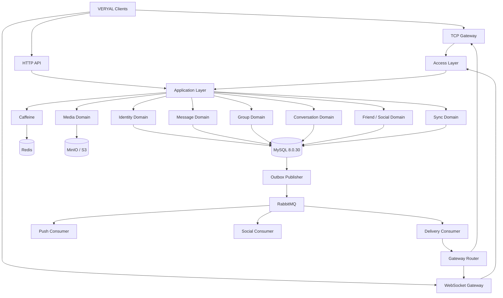
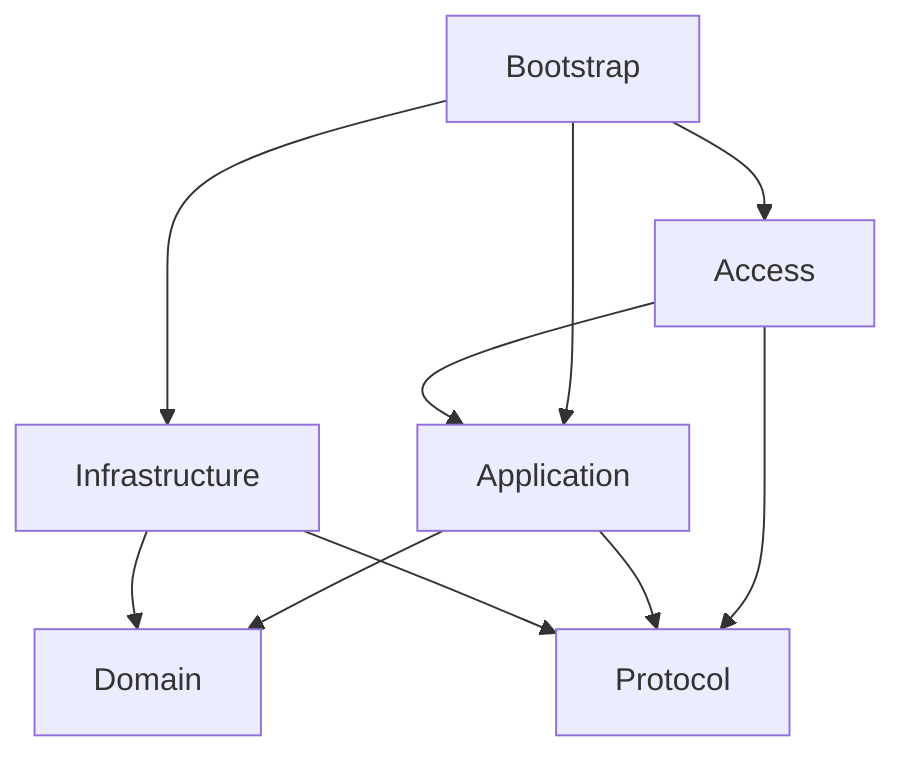
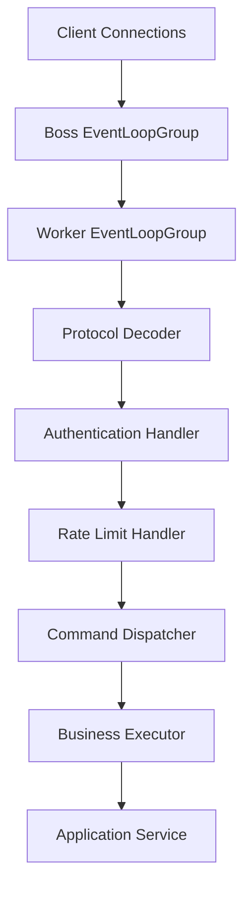
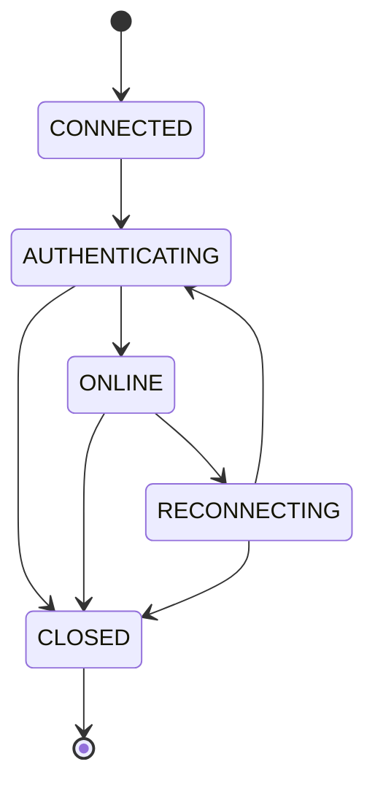
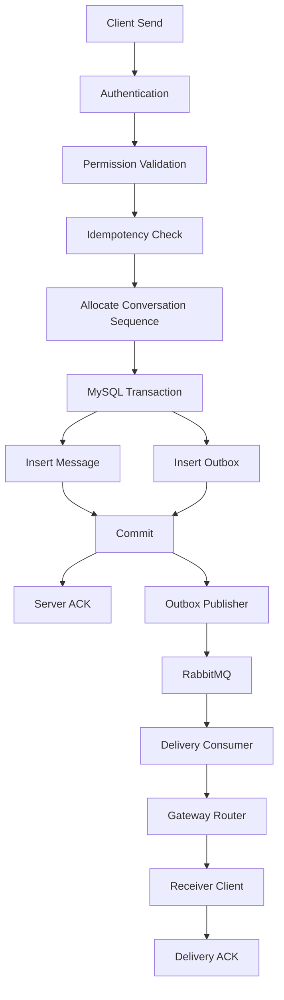
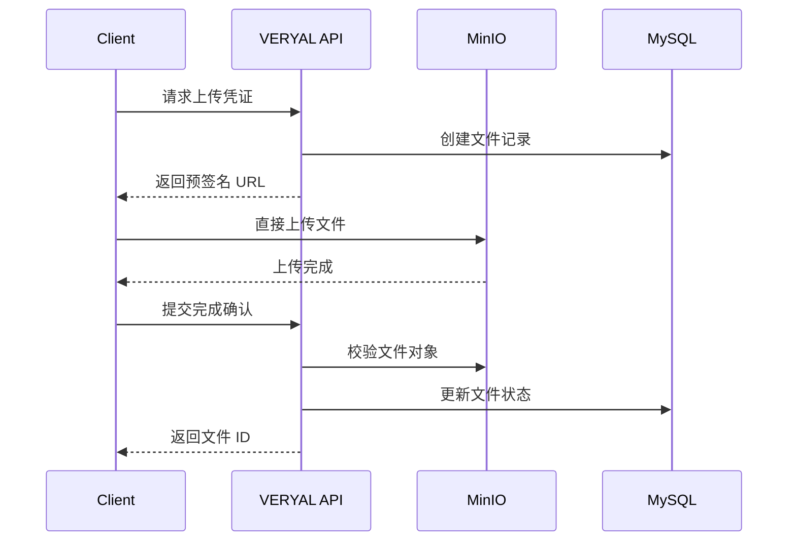
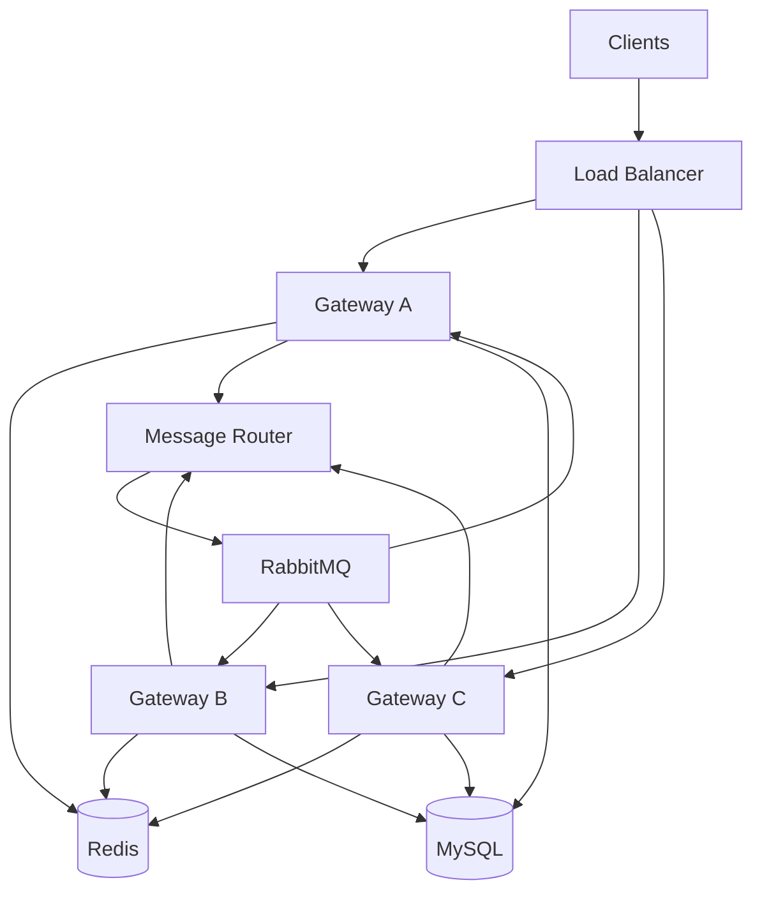

# VERYAL

## 高性能跨平台即时通讯系统——完整技术架构与开发设计文档

| 文档属性 | 内容 |
|---|---|
| 项目名称 | VERYAL |
| 项目类型 | 消费级社交即时通讯（类微信 / QQ） |
| 文档版本 | V1.1 |
| 文档状态 | 产品方向修订版 |
| 核心语言 | Java |
| JDK | Java 21 LTS |
| 网络框架 | Netty |
| 数据库 | MySQL 8.0.30 |
| 缓存 | Redis + Caffeine |
| 消息队列 | RabbitMQ |
| 通信协议 | Protobuf |
| Web 框架 | Spring Boot |
| ORM | MyBatis |
| 文件存储 | MinIO / S3 |
| 构建工具 | Maven |
| 部署方式 | Docker，后续支持 Kubernetes |
| 产品范围 | 单平台、单用户体系、无多租户 |
| 最后更新 | 2026-11-15 |

## 修订记录

| 版本 | 日期 | 说明 |
|---|---|---|
| V1.0 | 2026-11-14 | 初始开发基线，偏企业协作 / 多租户 / 开放平台方向 |
| V1.1 | 2026-11-15 | 产品方向调整为微信 / QQ 类消费级社交 IM；多租户、企业组织、OA 协作、开放平台移出一期范围 |

> **方向说明**
>
> 本版明确 VERYAL 做的是**面向个人用户的社交聊天产品**，不是飞书 / 企业微信类的组织协作平台。
>
> 因此：
>
> - 不再把多租户、企业组织架构、部门、审批、日历、文档协作作为产品能力；
> - 不再以“IM 开放平台 / SDK / 私有化部署”作为一期目标；
> - 当前代码已移除租户表、租户码登录、租户管理接口和租户管理员；数据库 `tenant_id` 列与 Java `tenantId` 字段/参数已全部移除，单平台单空间。
>
> 本版重点：账号、好友关系、单聊、群聊、富媒体消息、离线推送、多端同步、隐私与举报、运营后台。
>
> 配套前端设计：[FRONTEND-ARCHITECTURE.md](FRONTEND-ARCHITECTURE.md)

---

# 目录

- [第一章：项目定位与设计目标](#第一章项目定位与设计目标)
- [第二章：技术选型与架构决策](#第二章技术选型与架构决策)
- [第三章：VERYAL 总体架构](#第三章veryal-总体架构)
- [第四章：Maven 工程模块设计](#第四章maven-工程模块设计)
- [第五章：设计模式与工程规范](#第五章设计模式与工程规范)
- [第六章：Netty 网络架构](#第六章netty-网络架构)
- [第七章：VERYAL 通信协议设计](#第七章veryal-通信协议设计)
- [第八章：消息核心设计](#第八章消息核心设计)
- [第九章：MySQL 数据库设计](#第九章mysql-数据库设计)
- [第十章：RabbitMQ 消息队列设计](#第十章rabbitmq-消息队列设计)
- [第十一章：Redis 设计](#第十一章redis-设计)
- [第十二章：Caffeine 本地缓存设计](#第十二章caffeine-本地缓存设计)
- [第十三章：文件与媒体存储](#第十三章文件与媒体存储)
- [第十四章：GC 与性能优化](#第十四章gc-与性能优化)
- [第十五章：高可用架构](#第十五章高可用架构)
- [第十六章：安全设计](#第十六章安全设计)
- [第十七章：监控与日志](#第十七章监控与日志)
- [第十八章：测试体系](#第十八章测试体系)
- [第十九章：开发路线规划](#第十九章开发路线规划)
- [第二十章：核心开发规范](#第二十章核心开发规范)
- [第二十一章：VERYAL 第一阶段最终交付清单](#第二十一章veryal-第一阶段最终交付清单)
- [第二十二章：架构最终决策记录（ADR）](#第二十二章架构最终决策记录adr)
- [第二十三章：VERYAL 核心架构原则总结](#第二十三章veryal-核心架构原则总结)

---

# 第一章：项目定位与设计目标

## 1.1 项目定位

VERYAL 是一个面向个人用户的消费级即时通讯产品，产品形态参考微信和 QQ。

核心体验：

- 注册 / 登录，维护个人资料；
- 加好友、好友申请、备注、拉黑；
- 单聊；
- 群聊；
- 发送文字、表情、图片、语音、视频、文件；
- 多端同时在线与消息同步；
- 离线消息、离线推送；
- 隐私设置、举报、运营审核；
- 运营后台管理用户、群、内容和举报。

VERYAL 不是企业协作平台，不是飞书 / 企业微信的替代品。

## 1.2 明确不做的产品方向

以下能力不属于 VERYAL 一期范围：

- 企业组织架构、部门、员工通讯录；
- 审批、日历、在线文档、会议、OKR；
- 多租户 SaaS、租户开通、租户配额、租户计费；
- 平台租户管理员、租户数据导出 / 删除；
- 开放平台、第三方应用、机器人市场；
- 私有化部署作为商业交付形态。

> 多租户产品能力已经从代码中移除：租户表、租户码、租户管理接口、租户管理员、租户用量/导出/删除均已删除。
> 数据库与 Java 代码已移除 `tenant_id` / `tenantId`，单平台单空间。

## 1.3 产品形态

一期产品由三部分组成：

1. **移动端客户端**：iOS / Android，主聊天入口；
2. **Web 客户端**：浏览器聊天、文件、群管理；
3. **运营后台**：用户管理、群管理、内容审核、举报处理、数据统计。

未来可选：

- 朋友圈 / 动态；
- 语音通话 / 视频通话；
- 频道 / 公众号；
- 小程序 / 开放能力。

这些不进入一期。

## 1.4 核心设计目标

### 性能目标

- 支持大量 TCP / WebSocket 长连接。
- 降低单连接内存开销。
- 减少 JVM 对象分配。
- 降低 GC 压力。
- 提高消息处理吞吐量。
- 减少消息传输延迟。
- 支持水平扩展。

### 可靠性目标

- 消息可靠持久化。
- 消息幂等处理。
- 消息 ACK。
- 消息失败重试。
- 离线消息同步。
- 多端消息同步。
- 节点故障自动恢复。
- 消息顺序可追踪。

### 社交产品目标

- 好友关系双向确认。
- 好友申请、接受、拒绝、取消。
- 好友备注、删除好友。
- 黑名单、消息拒收。
- 群成员、群主、群管理员。
- 群公告、全员禁言、成员禁言、@ 成员。
- 隐私设置：是否允许手机号搜索、是否允许陌生人加好友。
- 举报、拉黑、内容审核。

### 账号安全目标

- 手机号 / 用户名 + 密码登录。
- 短信验证码登录（后续）。
- 设备管理、设备撤销。
- 登录风控、异常登录提醒。
- Token 过期与刷新。
- 密码错误锁定。
- 敏感操作二次确认。

### 可维护目标

- 采用 DDD 领域驱动设计。
- 采用模块化工程结构。
- 统一异常处理。
- 统一日志规范。
- 统一协议定义。
- 统一数据库访问规范。
- 统一监控体系。

## 1.5 第一阶段功能边界

一期必须完成：

### 账号

- 注册；
- 登录；
- 退出；
- 个人资料；
- 头像；
- 设备列表。

### 好友

- 搜索用户；
- 发送好友申请；
- 接受 / 拒绝 / 取消；
- 好友列表；
- 好友备注；
- 删除好友；
- 拉黑 / 解除拉黑。

### 单聊

- 创建单聊；
- 文本、表情、图片、语音、视频、文件；
- 消息历史；
- 已读 / 未读；
- 撤回；
- 断线同步。

### 群聊

- 建群；
- 邀请成员；
- 群主 / 管理员；
- 踢人、退群、转让群主、解散群；
- 群公告；
- 全员禁言 / 成员禁言；
- @ 成员；
- 群文件。

### 实时与多端

- WebSocket 长连接；
- 心跳；
- 多设备在线；
- 离线消息；
- 离线推送（APNs / FCM / 厂商通道）；
- 消息去重、顺序、ACK。

### 运营

- 用户管理；
- 群管理；
- 内容审核；
- 举报处理；
- 敏感词 / 风控（基础）；
- 运营数据统计。

## 1.6 第一阶段不做

为了控制范围，一期不做：

- 多租户、SaaS、企业组织架构；
- 审批、日历、文档、会议；
- 朋友圈 / 动态；
- 语音通话、视频通话；
- 红包、支付、转账；
- 直播、频道、公众号；
- 小程序、机器人、开放平台；
- 端到端加密；
- 跨地域多活；
- 自研分布式存储引擎。

但架构需要为这些能力预留扩展点，不影响一期交付。

## 1.7 产品角色

| 角色 | 说明 |
|---|---|
| 普通用户 | 聊天、好友、群、文件、个人设置 |
| 群主 | 群最高权限，可转让 / 解散群 |
| 群管理员 | 协助群主管理成员、公告、禁言 |
| 运营人员 | 平台后台，处理用户、群、内容、举报 |
| 平台管理员 | 运营后台最高权限，管理运营账号与系统配置 |

> 没有“租户管理员”角色。平台只有一个运营后台，服务所有用户。

---

# 第二章：技术选型与架构决策

## 2.1 最终技术栈

| 技术 | 选型 | 作用 |
|---|---|---|
| Java | Java 21 | 核心业务开发 |
| Netty | Netty 4.x | TCP / WebSocket 网络通信 |
| Spring Boot | Spring Boot 3.x | HTTP API、管理服务 |
| MySQL | MySQL 8.0.30 | 核心数据持久化 |
| Redis | Redis | 分布式缓存、在线状态 |
| Caffeine | Caffeine | JVM 本地缓存 |
| RabbitMQ | RabbitMQ | 异步事件分发 |
| Protobuf | Protocol Buffers | 二进制通信协议 |
| MyBatis | MyBatis | SQL 持久化 |
| HikariCP | HikariCP | 数据库连接池 |
| MinIO | S3 API | 文件和媒体存储 |
| Maven | Maven | 工程构建 |
| Docker | Docker | 容器化部署 |
| Prometheus | Prometheus | 指标采集 |
| Grafana | Grafana | 指标可视化 |
| OpenTelemetry | OTel | 链路追踪 |

版本策略：

- Java 使用 21 LTS。
- MySQL 固定兼容 8.0.30。
- RabbitMQ 选择官方支持的稳定版本。
- Redis 选择稳定版本。
- Netty 使用经过验证的 4.x 版本。
- Spring Boot 使用与 JDK 21 兼容的稳定版本。
- 所有依赖版本统一通过 Maven BOM 管理。

具体依赖版本需要在项目初始化时锁定，不使用动态版本。

## 2.2 为什么选择 Java + Netty

Java 具有成熟的工程生态。

Netty 提供：

- 高性能异步网络通信。
- EventLoop 事件驱动模型。
- ByteBuf 内存管理。
- 零拷贝相关能力。
- TCP 和 WebSocket 支持。
- 丰富的编解码器。
- 成熟的连接管理机制。

VERYAL 不需要因为追求理论性能而放弃 Java。

通过合理设计网络线程、对象分配、缓存、数据库访问和消息队列，可以建立性能良好的 IM 服务端。

## 2.3 为什么选择 MySQL 8.0.30

MySQL 负责：

- 用户信息。
- 设备信息。
- 好友关系。
- 群组信息。
- 会话信息。
- 消息记录。
- 消息序号。
- 消息投递状态。
- Outbox 事件。

使用 InnoDB 引擎。

主要原因：

- 事务能力成熟。
- 行级锁。
- 崩溃恢复。
- 索引能力成熟。
- Java 生态完善。
- 运维工具丰富。
- 方便未来分库分表。

VERYAL 不依赖 MySQL 8.4 的专属功能，所有数据库设计以 MySQL 8.0.30 为兼容基线。

## 2.4 为什么使用 RabbitMQ

RabbitMQ 作为 VERYAL 唯一的消息中间件。

负责：

- 消息异步分发。
- 群聊消息扇出。
- 推送任务。
- 好友 / 拉黑 / 举报事件。
- 系统事件。
- 审计任务。
- 文件处理任务。

RabbitMQ 不负责聊天消息的最终持久化。

MySQL 是聊天消息的可靠数据来源。

## 2.5 为什么使用 Redis + Caffeine

采用两级缓存：

L1：Caffeine。

- JVM 本地缓存。
- 极低访问延迟。
- 不需要网络请求。
- 适合热点业务数据。

L2：Redis。

- 分布式共享缓存。
- 用户在线状态。
- Gateway 路由。
- 多节点共享状态。
- 分布式限流。
- 分布式锁等必要能力。

MySQL 作为最终持久化数据源。

---

# 第三章：VERYAL 总体架构

## 3.1 系统架构



## 3.2 架构分层

### 第一层：Client Layer

负责客户端通信。

支持：

- Windows。
- macOS。
- Linux。
- Android。
- iOS。
- Web。

客户端统一使用 VERYAL Protocol。

### 第二层：Access Layer

负责：

- TCP 接入。
- WebSocket 接入。
- HTTP 接入。
- 协议解析。
- 消息编解码。
- 心跳。
- 连接管理。
- 认证入口。

不允许在网络 Handler 中直接操作数据库。

### 第三层：Application Layer

负责业务流程：

- 发送消息。
- 创建会话。
- 加入群组。
- 撤回消息。
- 同步消息。
- 修改用户资料。
- 处理设备上下线。

### 第四层：Domain Layer

负责：

- 用户。
- 设备。
- 消息。
- 会话。
- 群组。
- 好友。
- 在线状态。
- 投递状态。

### 第五层：Infrastructure Layer

负责：

- MySQL。
- Redis。
- Caffeine。
- RabbitMQ。
- MinIO。
- 服务发现。

---

# 第四章：Maven 工程模块设计

## 4.1 工程结构

```text
veryal/
│
├── pom.xml
│
├── veryal-common/
│   ├── common-core/
│   ├── common-id/
│   ├── common-json/
│   ├── common-exception/
│   └── common-observability/
│
├── veryal-protocol/
│   ├── protocol-api/
│   ├── protocol-protobuf/
│   └── proto/
│
├── veryal-access/
│   ├── access-tcp/
│   ├── access-websocket/
│   └── access-http/
│
├── veryal-domain/
│   ├── domain-identity/
│   ├── domain-device/
│   ├── domain-message/
│   ├── domain-conversation/
│   ├── domain-group/
│   ├── domain-friend/
│   ├── domain-presence/
│   ├── domain-delivery/
│   └── domain-media/
│
├── veryal-application/
│   ├── application-identity/
│   ├── application-message/
│   ├── application-conversation/
│   ├── application-group/
│   ├── application-friend/
│   ├── application-moderation/
│   ├── application-sync/
│   └── application-delivery/
│
├── veryal-infrastructure/
│   ├── infrastructure-mysql/
│   ├── infrastructure-redis/
│   ├── infrastructure-cache/
│   ├── infrastructure-rabbitmq/
│   ├── infrastructure-storage/
│   └── infrastructure-discovery/
│
├── veryal-bootstrap/
│
├── veryal-admin/
│
├── veryal-test/
│
└── deploy/
    ├── docker/
    ├── mysql/
    ├── redis/
    ├── rabbitmq/
    └── nginx/
```

## 4.2 模块职责

### common-core

统一基础类型和通用组件。

禁止存放具体业务。

### protocol

维护 Protobuf 协议文件。

客户端、移动端和 Web 端从这里生成协议代码；不对外提供第三方 SDK。

### access-tcp

负责 Netty TCP Server。

### access-websocket

负责 WebSocket 接入。

### access-http

负责 HTTP API 接入。

### domain-identity

用户身份、账号和认证领域。

### domain-device

设备信息、设备绑定和设备状态。

### domain-message

消息实体、消息类型、消息规则。

### domain-conversation

单聊和群聊会话管理。

### domain-group

群组、成员、管理员和群权限。

### domain-friend

好友关系和黑名单。

### domain-presence

在线状态。

### domain-delivery

消息投递、投递记录和投递状态。

### infrastructure-mysql

MySQL Repository 实现。

### infrastructure-redis

Redis 访问实现。

### infrastructure-cache

统一缓存门面，封装 Caffeine 和 Redis。

### infrastructure-rabbitmq

RabbitMQ 发布和消费实现。

### infrastructure-storage

MinIO / S3 文件存储实现。

## 4.3 依赖规则



核心约束：

1. Domain 不依赖 Netty。
2. Domain 不依赖 Spring。
3. Domain 不依赖 MyBatis。
4. Domain 不依赖 Redis。
5. Application 依赖领域接口。
6. Infrastructure 实现 Repository。
7. Access 只负责接入和分发。
8. Bootstrap 负责启动和装配。

---

# 第五章：设计模式与工程规范

## 5.1 DDD 领域驱动设计

VERYAL 采用领域划分：

- Identity Domain。
- Device Domain。
- Message Domain。
- Conversation Domain。
- Group Domain。
- Friend Domain。
- Presence Domain。
- Delivery Domain。
- Media Domain。

每个领域有明确的职责和边界。

## 5.2 重点设计模式

| 设计模式 | 应用位置 |
|---|---|
| Strategy | 不同消息类型处理 |
| Factory | 消息对象创建 |
| Chain of Responsibility | 消息校验和认证 |
| Observer | 领域事件 |
| State Machine | 消息状态、连接状态 |
| Repository | 数据持久化 |
| Adapter | 存储和通信适配 |
| Template Method | 统一消息处理流程 |
| CQRS | 消息读写分离 |
| Outbox | 数据库与消息队列可靠衔接 |

## 5.3 消息策略模式

```java
public interface MessageHandler<T> {

    MessageType supports();

    void handle(
        MessageContext context,
        T body
    );
}
```

具体实现：

```java
@Component
public class TextMessageHandler
        implements MessageHandler<TextMessageBody> {

    @Override
    public MessageType supports() {
        return MessageType.TEXT;
    }

    @Override
    public void handle(
            MessageContext context,
            TextMessageBody body) {

        // 文本消息业务处理
    }
}
```

未来扩展：

- TextMessageHandler。
- ImageMessageHandler。
- FileMessageHandler。
- AudioMessageHandler。
- VideoMessageHandler。
- SystemMessageHandler。
- StickerMessageHandler。

统一业务流程由 MessageApplicationService 编排。

---

# 第六章：Netty 网络架构

## 6.1 网络模型

采用 Netty EventLoop 模型。



## 6.2 线程职责

### Boss EventLoop

负责接收连接。

### Worker EventLoop

负责：

- 网络读写。
- 协议解码。
- 协议编码。
- 心跳。
- Channel 生命周期。

### Business Executor

负责：

- 数据库操作。
- Redis 操作。
- 消息业务处理。
- 群组权限校验。
- 消息持久化。

### Delivery Executor

负责：

- 消息投递。
- Gateway 路由。
- Channel 写入调度。

不同业务线程池应设置容量限制和拒绝策略。

## 6.3 连接管理

定义：

```java
public interface ConnectionRegistry {

    void register(Connection connection);

    void unregister(String connectionId);

    Connection find(String connectionId);

    List<Connection> findByUserId(Long userId);

}
```

连接对象至少保存：

- connectionId。
- userId。
- deviceId。
- gatewayId。
- channel。
- connectTime。
- lastHeartbeat。
- protocolVersion。
- connectionStatus。

注意：

Channel 是当前 Gateway 本地对象，不能放进 Redis。

Redis 只保存连接路由元数据。

## 6.4 连接生命周期



---

# 第七章：VERYAL 通信协议设计

## 7.1 协议目标

- 跨平台。
- 高效。
- 低开销。
- 向后兼容。
- 可扩展。
- 统一版本管理。
- TCP 和 WebSocket 共用业务消息定义。

## 7.2 传输协议

| 方式 | 使用场景 |
|---|---|
| TCP | 原生客户端 |
| WebSocket | Web 客户端 |
| HTTP | 管理接口和业务 API |
| HTTPS | 安全 API |

TCP 与 WebSocket 使用同一套 Protobuf Envelope。

## 7.3 自定义帧格式

VERYAL V1 使用固定 16 字节协议头。

| 字段 | 长度 | 说明 |
|---|---:|---|
| Magic | 4 | 协议魔数 |
| Version | 1 | 协议版本 |
| Flags | 1 | 标记 |
| Command | 2 | 指令 |
| Sequence | 4 | 传输序号 |
| Body Length | 4 | 消息体长度 |
| Payload | N | Protobuf 数据 |

协议约定：

- Big Endian。
- 最大消息帧长度受配置限制。
- TCP 使用长度字段拆包。
- WebSocket 使用 Binary Frame。
- 所有消息体使用 Protobuf。
- 协议版本必须兼容。
- 禁止重复使用已废弃字段编号。

## 7.4 Envelope

```protobuf
syntax = "proto3";

package veryal.protocol;

message Envelope {

  uint32 protocol_version = 1;

  string request_id = 2;

  string trace_id = 3;

  uint32 command = 4;

  bytes payload = 5;

}
```

## 7.5 消息发送协议

```protobuf
message SendMessageRequest {

  string client_message_id = 1;

  string conversation_id = 2;

  uint32 message_type = 3;

  bytes content = 4;

  uint64 client_sequence = 5;

}
```

## 7.6 ACK 协议

```protobuf
message ServerAck {

  string client_message_id = 1;

  string server_message_id = 2;

  uint64 conversation_sequence = 3;

  uint32 status = 4;

}
```

```protobuf
message DeliveryAck {

  string message_id = 1;

  string device_id = 2;

  uint64 delivered_sequence = 3;

}
```

```protobuf
message ReadAck {

  string conversation_id = 1;

  uint64 read_sequence = 2;

}
```

三种 ACK 的含义不同：

- Server ACK：消息已经完成持久化。
- Delivery ACK：接收端已经收到消息。
- Read ACK：用户已经阅读消息。

---

# 第八章：消息核心设计

## 8.1 消息生命周期



## 8.2 消息可靠性原则

VERYAL 不承诺分布式系统绝对 exactly-once。

采用：

At-least-once Delivery + Idempotency + Persistent Cursor。

通过：

- 唯一客户端消息 ID。
- 服务端消息 ID。
- 会话序号。
- 数据库事务。
- Outbox。
- RabbitMQ 确认。
- 消费者幂等。
- 客户端去重。
- 离线同步。

实现用户层面的可靠消息体验。

## 8.3 消息序号

每个会话独立维护消息序号。

```text
conversation_id
    |
    +-- seq 1
    +-- seq 2
    +-- seq 3
    +-- seq 4
    +-- seq 5
```

建议使用会话序号表：

```sql
CREATE TABLE im_conversation_sequence (
    conversation_id VARCHAR(64) NOT NULL,
    last_seq BIGINT NOT NULL DEFAULT 0,
    PRIMARY KEY (conversation_id)
) ENGINE=InnoDB;
```

分配序号时：

```sql
UPDATE im_conversation_sequence
SET last_seq = LAST_INSERT_ID(last_seq + 1)
WHERE conversation_id = ?;
```

在同一个数据库连接和事务中读取：

```sql
SELECT LAST_INSERT_ID();
```

实际实现必须处理会话初始化、事务回滚和死锁重试。

不要使用全局序号控制所有会话。

## 8.4 单聊消息

1. 验证发送者。
2. 验证会话成员关系。
3. 检查幂等。
4. 分配会话序号。
5. 写入消息。
6. 写入 Outbox。
7. 提交事务。
8. 返回 Server ACK。
9. 异步投递接收端。
10. 等待 Delivery ACK。

## 8.5 群聊消息

群聊采用异步扇出。

消息只持久化一次，随后由消费者负责成员分发。

小群：

- 在线成员实时投递。

中群：

- 批量分发。

大群：

- 异步分发。
- 分批获取成员。
- 离线成员通过同步游标拉取。

不能在一个数据库事务中循环给所有群成员发送消息。

## 8.6 离线消息同步

客户端保存每个会话的同步游标。

接口：

```text
GET /sync/messages

conversation_id=xxx
cursor=100
limit=100
```

返回：

```json
{
  "conversationId": "xxx",
  "messages": [],
  "nextCursor": 200,
  "hasMore": true
}
```

使用游标分页，不使用 OFFSET 分页。

断线重连后：

1. 重新认证。
2. 获取会话列表。
3. 上传各会话同步游标。
4. 服务端补发缺失消息。
5. 更新客户端游标。
6. 恢复实时接收。

## 8.7 好友关系设计

好友关系是消费级 IM 的核心，不依附于组织架构。

### 申请状态机

```text
PENDING
  ├── ACCEPTED
  ├── REJECTED
  ├── CANCELED
  └── EXPIRED

REJECTED / CANCELED / EXPIRED
  └── 可重新发起申请
```

规则：

- 不能添加自己；
- 已是好友不能重复申请；
- 同一对用户同一时间只允许一条待处理申请；
- 对方拒绝或自己取消后，允许重新申请；
- 拉黑后不能发起申请；
- 好友关系建立后，双方各写一条好友记录，便于各自备注、删除和查询。

### 好友数据

- 好友申请：`from_user_id`、`to_user_id`、附言、状态、时间；
- 好友关系：`user_id`、`friend_id`、备注、来源、时间；
- 黑名单：`user_id`、`blocked_user_id`、时间。

好友列表查询只查当前用户自己的好友记录，不做全表扫描。

### 好友事件

通过 Outbox 发布：

```text
friend.requested
friend.accepted
friend.rejected
friend.canceled
friend.blocked
friend.unblocked
```

在线用户实时推送 `FRIEND_NOTIFY`；离线用户通过同步接口补拉申请列表。

## 8.8 黑名单、隐私与举报

### 黑名单

黑名单是单向关系：

- A 拉黑 B，B 不一定是 A 的黑名单；
- A 拉黑 B 后，自动解除好友关系；
- B 发给 A 的私聊消息被拒绝；
- A 仍然可以在群聊中看到 B 的群消息（群聊不做个人黑名单过滤）；
- 解除拉黑不会自动恢复好友关系。

### 隐私设置

用户可配置：

- 是否允许通过手机号搜索到我；
- 是否允许通过用户名搜索到我；
- 是否允许陌生人加好友；
- 是否展示在线状态；
- 是否展示已读回执；
- 是否允许被邀请进群；
- 加好友验证方式：直接通过 / 需要验证 / 拒绝。

隐私判断在服务端完成，不能只依赖客户端。

### 举报与内容审核

- 用户可举报消息、用户、群；
- 举报写入审核表，进入运营后台；
- 运营可警告、禁言、封号、解散群；
- 敏感词、图片内容审核作为后续能力；
- 审核操作必须审计。

## 8.9 群聊产品设计

### 群角色

| 角色 | 权限 |
|---|---|
| 群主 | 全部权限，转让、解散、设置管理员 |
| 管理员 | 踢人、禁言、公告、审核入群 |
| 成员 | 发消息、看历史、退群 |

### 群规则

- 群人数上限一期 1000；
- 群主不能直接退群，必须先转让；
- 管理员不能踢群主或其他管理员；
- 全员禁言时，群主 / 管理员仍可发言；
- 成员禁言到期自动恢复；
- @ 成员必须是本群成员；
- 群公告、禁言、@ 的变更需要实时或同步可见。

### 群与会话

群 ID 与群会话 ID 保持一致，简化消息权限与历史查询。

群消息只持久化一次，投递时按成员分页扇出，不在一个事务里循环所有成员。

### 群文件

- 文件绑定群会话；
- 群成员可访问；
- 未绑定会话的文件仅上传者可见；
- 文件消息引用文件 ID，不直接携带文件本体。

## 8.10 离线推送与多端同步

消费级 IM 必须支持用户离线时收到提醒。

### 推送通道

一期至少支持：

- APNs；
- FCM；
- 国内 Android 厂商通道（华为 / 小米 / OPPO / vivo，按接入优先级）；
- Web Push 可选。

### 设备 token

- 客户端登录后注册推送 token；
- token 与 userId、deviceId、platform 绑定；
- token 失效时标记失效，不继续投递；
- 用户退出 / 卸载时注销。

### 推送内容

只推送摘要，不推送完整敏感内容：

```json
{
  "type": "MESSAGE",
  "conversationId": "c_1001_1002",
  "senderId": 1001,
  "title": "新消息",
  "body": "你好",
  "unreadCount": 3
}
```

点击通知后进入对应会话，再通过同步接口拉取完整消息。

### 多端同步

- 同一账号允许多设备在线；
- 每个设备独立投递游标；
- 任一设备已读，其他设备同步已读状态；
- 新设备登录后从最近游标开始同步；
- 不使用“最后登录设备覆盖”模型。

## 8.11 消费级 IM 的消息类型

一期支持：

| 类型 | 说明 |
|---|---|
| TEXT | 文本 |
| EMOJI | 表情 / 贴纸 |
| IMAGE | 图片 |
| AUDIO | 语音 |
| VIDEO | 视频 |
| FILE | 文件 |
| SYSTEM | 系统提示 |

后续可选：

- 位置；
- 名片；
- 红包 / 转账；
- 引用；
- 合并转发；
- 动态表情。

---

# 第九章：MySQL 数据库设计

## 9.1 数据库规范

> 本文档的目标模型不包含 `tenant_id`。
>
> 当前实现已删除该列及 Java 兼容字段，单平台单空间。

数据库：

```text
veryal_im
```

引擎：

```text
InnoDB
```

字符集：

```text
utf8mb4
```

时区：

```text
UTC
```

数据库规范：

- 主键统一使用 BIGINT 或明确的字符串业务 ID。
- 时间字段使用 DATETIME(3)。
- 消息内容使用二进制或结构化内容字段。
- 核心业务表必须有创建时间和更新时间。
- 合理设计唯一索引。
- 避免无意义的大量索引。
- 所有 SQL 必须可追踪。
- 数据库变更必须使用版本化迁移脚本。

## 9.2 核心表结构

### 用户表

```sql
CREATE TABLE im_user (
    id BIGINT NOT NULL PRIMARY KEY,
    username VARCHAR(64) NOT NULL,
    phone VARCHAR(32),
    email VARCHAR(128),
    password_hash VARCHAR(255) NOT NULL,
    nickname VARCHAR(128),
    avatar VARCHAR(512),
    status TINYINT NOT NULL DEFAULT 1,
    created_at DATETIME(3) NOT NULL,
    updated_at DATETIME(3) NOT NULL,

    UNIQUE KEY uk_username (username),
    UNIQUE KEY uk_phone (phone),
    UNIQUE KEY uk_email (email)
) ENGINE=InnoDB DEFAULT CHARSET=utf8mb4;
```

说明：

- 用户名全局唯一；
- 手机号、邮箱可为空，但非空时全局唯一；
- 密码只存哈希，不存明文；
- 消费级产品不引入 `tenant_id`。

### 设备表

```sql
CREATE TABLE im_device (
    id BIGINT NOT NULL PRIMARY KEY,
    user_id BIGINT NOT NULL,
    device_id VARCHAR(64) NOT NULL,
    platform VARCHAR(32) NOT NULL,
    device_name VARCHAR(128),
    last_login_at DATETIME(3),
    created_at DATETIME(3) NOT NULL,

    UNIQUE KEY uk_device_id (device_id),
    KEY idx_user_id (user_id)
) ENGINE=InnoDB DEFAULT CHARSET=utf8mb4;
```

### 好友申请表

```sql
CREATE TABLE im_friend_request (
    id BIGINT NOT NULL PRIMARY KEY,
    from_user_id BIGINT NOT NULL,
    to_user_id BIGINT NOT NULL,
    message VARCHAR(255),
    status TINYINT NOT NULL DEFAULT 0,
    created_at DATETIME(3) NOT NULL,
    updated_at DATETIME(3) NOT NULL,

    KEY idx_to_status (to_user_id, status, created_at),
    KEY idx_from_status (from_user_id, status, created_at)
) ENGINE=InnoDB DEFAULT CHARSET=utf8mb4;
```

状态：

- 0：待处理；
- 1：已接受；
- 2：已拒绝；
- 3：已取消；
- 4：已过期。

“同一对用户只允许一条待处理申请”由应用层事务 + 查询保证；MySQL 不支持部分唯一索引。

### 好友关系表

```sql
CREATE TABLE im_friend (
    id BIGINT NOT NULL PRIMARY KEY,
    user_id BIGINT NOT NULL,
    friend_id BIGINT NOT NULL,
    remark VARCHAR(64),
    source VARCHAR(32),
    created_at DATETIME(3) NOT NULL,
    updated_at DATETIME(3) NOT NULL,

    UNIQUE KEY uk_user_friend (user_id, friend_id),
    KEY idx_friend_id (friend_id)
) ENGINE=InnoDB DEFAULT CHARSET=utf8mb4;
```

好友关系双向写入两条记录：

```text
A -> B
B -> A
```

这样每个用户都可以独立设置备注、删除好友，不影响对方的历史数据。

### 黑名单表

```sql
CREATE TABLE im_blacklist (
    id BIGINT NOT NULL PRIMARY KEY,
    user_id BIGINT NOT NULL,
    blocked_user_id BIGINT NOT NULL,
    created_at DATETIME(3) NOT NULL,

    UNIQUE KEY uk_user_blocked (user_id, blocked_user_id),
    KEY idx_blocked_user (blocked_user_id)
) ENGINE=InnoDB DEFAULT CHARSET=utf8mb4;
```

黑名单是单向关系，只影响被拉黑者发给拉黑者的私聊消息。

### 用户隐私设置表

```sql
CREATE TABLE im_user_privacy (
    user_id BIGINT NOT NULL PRIMARY KEY,
    search_by_phone TINYINT NOT NULL DEFAULT 1,
    search_by_username TINYINT NOT NULL DEFAULT 1,
    friend_policy TINYINT NOT NULL DEFAULT 1,
    show_online TINYINT NOT NULL DEFAULT 1,
    read_receipt TINYINT NOT NULL DEFAULT 1,
    invited_to_group TINYINT NOT NULL DEFAULT 1,
    updated_at DATETIME(3) NOT NULL
) ENGINE=InnoDB DEFAULT CHARSET=utf8mb4;
```

`friend_policy`：

- 0：拒绝任何人；
- 1：需要验证；
- 2：允许直接添加。

### 举报表

```sql
CREATE TABLE im_report (
    id BIGINT NOT NULL PRIMARY KEY,
    reporter_id BIGINT NOT NULL,
    target_type VARCHAR(16) NOT NULL,
    target_id VARCHAR(64) NOT NULL,
    reason VARCHAR(64) NOT NULL,
    detail VARCHAR(512),
    status TINYINT NOT NULL DEFAULT 0,
    handled_by BIGINT,
    handled_at DATETIME(3),
    created_at DATETIME(3) NOT NULL,

    KEY idx_report_status (status, created_at),
    KEY idx_report_target (target_type, target_id)
) ENGINE=InnoDB DEFAULT CHARSET=utf8mb4;
```

`target_type`：`USER` / `GROUP` / `MESSAGE`。

状态：

- 0：待处理；
- 1：处理中；
- 2：已处理；
- 3：已驳回。

### 会话表

```sql
CREATE TABLE im_conversation (
    id VARCHAR(64) NOT NULL PRIMARY KEY,
    conversation_type TINYINT NOT NULL,
    created_at DATETIME(3) NOT NULL,
    updated_at DATETIME(3) NOT NULL,

    KEY idx_type (conversation_type, updated_at)
) ENGINE=InnoDB DEFAULT CHARSET=utf8mb4;
```

### 会话成员表

```sql
CREATE TABLE im_conversation_member (
    id BIGINT NOT NULL PRIMARY KEY,
    conversation_id VARCHAR(64) NOT NULL,
    user_id BIGINT NOT NULL,
    last_read_seq BIGINT NOT NULL DEFAULT 0,
    last_sync_seq BIGINT NOT NULL DEFAULT 0,
    joined_at DATETIME(3) NOT NULL,

    UNIQUE KEY uk_conversation_user (
        conversation_id,
        user_id
    ),

    KEY idx_user_id (user_id)
) ENGINE=InnoDB DEFAULT CHARSET=utf8mb4;
```

### 消息表

```sql
CREATE TABLE im_message (
    id BIGINT NOT NULL PRIMARY KEY,
    conversation_id VARCHAR(64) NOT NULL,
    sender_id BIGINT NOT NULL,
    client_msg_id VARCHAR(64) NOT NULL,
    seq BIGINT NOT NULL,
    msg_type SMALLINT NOT NULL,
    content MEDIUMBLOB NOT NULL,
    created_at DATETIME(3) NOT NULL,
    recalled_at DATETIME(3),
    recalled_by BIGINT,

    UNIQUE KEY uk_sender_client_msg (
        sender_id,
        client_msg_id
    ),

    UNIQUE KEY uk_conversation_seq (
        conversation_id,
        seq
    ),

    KEY idx_conversation_time (
        conversation_id,
        created_at
    )
) ENGINE=InnoDB DEFAULT CHARSET=utf8mb4;
```

说明：

- 消息 ID 由应用层生成。
- client_msg_id 用于幂等。
- seq 用于会话排序。
- content 保存序列化后的消息内容。
- 大文件只保存引用，不保存文件本体。

生产版本需要根据实际分片方案确定唯一索引和主键结构。

### 群表

```sql
CREATE TABLE im_group (
    id VARCHAR(64) NOT NULL PRIMARY KEY,
    name VARCHAR(128) NOT NULL,
    owner_id BIGINT NOT NULL,
    max_members INT NOT NULL DEFAULT 1000,
    created_at DATETIME(3) NOT NULL,
    updated_at DATETIME(3) NOT NULL,

    KEY idx_owner (owner_id)
) ENGINE=InnoDB DEFAULT CHARSET=utf8mb4;
```

群 ID 与群会话 ID 一致。

### 群成员表

```sql
CREATE TABLE im_group_member (
    id BIGINT NOT NULL PRIMARY KEY,
    group_id VARCHAR(64) NOT NULL,
    user_id BIGINT NOT NULL,
    role TINYINT NOT NULL DEFAULT 0,
    joined_at DATETIME(3) NOT NULL,

    UNIQUE KEY uk_group_user (group_id, user_id),
    KEY idx_group_member_user (user_id)
) ENGINE=InnoDB DEFAULT CHARSET=utf8mb4;
```

角色：

- 0：成员；
- 1：管理员；
- 2：群主。

### 群设置表

```sql
CREATE TABLE im_group_setting (
    group_id VARCHAR(64) NOT NULL PRIMARY KEY,
    announcement TEXT,
    mute_all TINYINT NOT NULL DEFAULT 0,
    updated_at DATETIME(3) NOT NULL,
    updated_by BIGINT NOT NULL
) ENGINE=InnoDB DEFAULT CHARSET=utf8mb4;
```

### 群成员禁言表

```sql
CREATE TABLE im_group_mute (
    group_id VARCHAR(64) NOT NULL,
    user_id BIGINT NOT NULL,
    muted_until DATETIME(3) NOT NULL,
    created_at DATETIME(3) NOT NULL,

    PRIMARY KEY (group_id, user_id)
) ENGINE=InnoDB DEFAULT CHARSET=utf8mb4;
```

### Outbox 表

```sql
CREATE TABLE im_outbox (
    id BIGINT NOT NULL PRIMARY KEY,
    event_id VARCHAR(64) NOT NULL,
    aggregate_id VARCHAR(64) NOT NULL,
    event_type VARCHAR(64) NOT NULL,
    payload MEDIUMBLOB NOT NULL,
    status TINYINT NOT NULL DEFAULT 0,
    retry_count INT NOT NULL DEFAULT 0,
    created_at DATETIME(3) NOT NULL,
    published_at DATETIME(3),

    UNIQUE KEY uk_event_id (event_id),

    KEY idx_status_created (
        status,
        created_at
    )
) ENGINE=InnoDB DEFAULT CHARSET=utf8mb4;
```

状态：

- 0：待发布。
- 1：已发布。
- 2：等待重试。
- 3：失败，需要人工或自动补偿。

Outbox Publisher 使用批量查询和状态抢占机制，避免多个实例重复处理同一条记录。

发布成功后，收到 RabbitMQ Publisher Confirm，再更新状态。

注意：发布确认与数据库状态更新之间仍可能出现重复发布，所以消费者必须幂等。

## 9.3 事务规范

消息写入：

```text
BEGIN

1. 检查幂等键
2. 分配会话序号
3. 插入消息
4. 插入 Outbox 事件

COMMIT
```

不要在事务提交之前调用 RabbitMQ 网络发布。

## 9.4 消息存储扩展

第一阶段：

- 单 MySQL。
- 合理索引。
- 游标分页。
- 监控慢 SQL。

第二阶段：

- 按时间或业务分区。
- 评估读副本。
- 设计逻辑分片路由。

第三阶段：

- 按 conversation_id 哈希分片。
- 建立独立消息存储节点。
- 实施冷热数据分层。

不要过早进行分库分表。

---

# 第十章：RabbitMQ 消息队列设计

## 10.1 RabbitMQ 定位

RabbitMQ 是 VERYAL 的异步事件总线。

它不承担：

- 聊天历史消息最终存储。
- 用户消息同步游标存储。
- 客户端消息 ACK 状态的最终存储。

## 10.2 Exchange 设计

| Exchange | 类型 | 作用 |
|---|---|---|
| veryal.message.exchange | Topic | 消息事件 |
| veryal.social.exchange | Topic | 好友、拉黑、举报事件 |
| veryal.group.exchange | Topic | 群组事件 |
| veryal.push.exchange | Topic | 推送事件 |
| veryal.system.exchange | Topic | 系统事件 |
| veryal.retry.exchange | Direct | 重试 |
| veryal.dlx.exchange | Direct | 死信 |

## 10.3 Routing Key

```text
message.private.created
message.group.created

message.delivery.requested
message.delivery.failed

friend.requested
friend.accepted
friend.rejected
friend.canceled
friend.blocked
friend.unblocked

group.member.joined
group.member.left

push.notification.requested

system.user.online
system.user.offline
```

## 10.4 Queue 设计

```text
veryal-message-delivery-queue
veryal-group-fanout-queue
veryal-social-queue
veryal-push-queue
veryal-audit-queue
veryal-dead-letter-queue
```

每种业务使用独立 Queue。

避免推送业务积压影响正常聊天投递。

## 10.5 可靠性设计

生产者：

- Durable Exchange。
- Durable Queue。
- Persistent Message。
- Publisher Confirm。
- Publisher Return。
- 发布失败重试。

消费者：

- Manual ACK。
- Consumer Idempotency。
- Prefetch。
- 有限重试。
- 死信队列。

关键业务队列根据 RabbitMQ 版本选择 Quorum Queue。

## 10.6 重试设计

采用有限次数重试。

```text
First Failure
    |
Retry 1
    |
Retry 2
    |
Retry 3
    |
Dead Letter Queue
```

采用指数退避和随机抖动。

不要无限重试。

对于业务永久失败的消息，应进入死信队列并记录失败原因。

## 10.7 消息顺序

RabbitMQ 多消费者并发处理不能保证全局业务顺序。

VERYAL 以 conversation_id + seq 作为消息顺序依据。

对于必须保持顺序的同一会话，可以采用：

- 一致性分区路由。
- 同会话串行消费。
- 消费端序号检查。
- 缺失序号补偿。

不能只依赖 RabbitMQ 的队列 FIFO 来保证最终用户看到的消息顺序。

---

# 第十一章：Redis 设计

## 11.1 Redis 主要职责

- 用户在线状态。
- Gateway 路由。
- 连接元数据。
- 分布式缓存。
- 限流。
- 临时状态。
- 必要的分布式协调。

## 11.2 Key 设计

```text
veryal:presence:user:{userId}

veryal:connection:{connectionId}

veryal:gateway:{gatewayId}

veryal:user:devices:{userId}

veryal:cache:user:{userId}

veryal:cache:group:{groupId}

veryal:cache:conversation:{conversationId}
```

## 11.3 在线状态结构

```json
{
  "userId": "10001",
  "deviceId": "device-001",
  "gatewayId": "gateway-001",
  "connectionId": "conn-001",
  "lastHeartbeat": 1790000000,
  "status": "ONLINE"
}
```

同一个用户可以多个设备同时在线。

不能简单将 userId 映射到一个 connectionId。

## 11.4 心跳和租约

客户端定期发送心跳。

Gateway 更新连接租约。

如果超过租约时间没有续期，连接状态被认为失效。

租约更新必须校验当前节点和连接身份，避免旧连接误删新连接。

Redis 过期事件不能作为唯一的在线状态清理依据，应有主动校验和周期性补偿任务。

---

# 第十二章：Caffeine 本地缓存设计

## 12.1 Caffeine 定位

Caffeine 是 JVM 进程内缓存。

VERYAL 采用：

L1：Caffeine。

L2：Redis。

L3：MySQL。

## 12.2 推荐缓存内容

| 内容 | 是否推荐 |
|---|---|
| 用户基础资料 | 是 |
| 群组基础信息 | 是 |
| 群成员热点数据 | 是 |
| 会话元数据 | 是 |
| 权限信息 | 是 |
| 消息历史 | 选择性 |
| 在线连接 Channel | 本地连接注册表，不作为普通缓存 |
| 全局在线状态 | Redis |

## 12.3 Caffeine 示例

```java
@Bean
public Cache<Long, UserInfo> userCache() {

    return Caffeine.newBuilder()
            .maximumSize(100_000)
            .expireAfterWrite(
                Duration.ofMinutes(10)
            )
            .recordStats()
            .build();
}
```

## 12.4 缓存失效机制

用户更新资料：

1. 更新 MySQL。
2. 删除 Redis 用户缓存。
3. 发布用户资料变更事件。
4. 各 Gateway 清除本地 Caffeine 缓存。
5. 缓存过期时间作为兜底。

需要处理事件重复、事件丢失和节点短暂离线的情况。

本地缓存不具备天然的分布式一致性。

---

# 第十三章：文件与媒体存储

## 13.1 文件存储原则

聊天文件不直接写入 MySQL 消息表。

使用 MinIO / S3 保存文件。

MySQL 只保存文件元数据。

## 13.2 上传流程



## 13.3 功能要求

- 分片上传。
- 断点续传。
- 文件完整性校验。
- SHA-256。
- 临时签名 URL。
- 文件访问权限。
- 文件生命周期。
- 文件删除。
- CDN 加速接口预留。

---

# 第十四章：GC 与性能优化

## 14.1 核心原则

减少对象分配。

减少内存复制。

减少同步阻塞。

避免无界队列。

隔离网络线程和业务线程。

控制缓存容量。

## 14.2 Netty 内存管理

建议：

- 使用 ByteBuf。
- 评估池化分配器。
- 正确管理引用计数。
- 避免不必要的 retain / release。
- 避免重复 ByteBuf 转换。
- 设置最大帧长度。
- 控制写缓冲区水位。

池化不一定对所有场景都有利，需要通过压测验证。

## 14.3 JVM 优化

第一阶段：

- G1 GC。
- 监控分配速率。
- 监控 GC Pause。
- 监控堆内存。
- 监控 Direct Memory。
- 监控线程数量。

后续：

- 对比 ZGC。
- 分析对象分配热点。
- 使用 JFR。
- 使用 async-profiler。
- 优化热点代码。

不要在没有基准测试的情况下直接调整大量 JVM 参数。

## 14.4 数据库优化

- HikariCP。
- SQL 索引优化。
- 游标分页。
- 批量写入。
- 避免 N+1 查询。
- 避免长事务。
- 慢 SQL 监控。
- 读写分离按需引入。

## 14.5 RabbitMQ 优化

- 限制 Consumer Prefetch。
- 控制消息体大小。
- 避免阻塞消费者。
- 控制重试速率。
- 监控 Queue Depth。
- 分离不同业务队列。
- 设置积压告警。

---

# 第十五章：高可用架构

## 15.1 Gateway 集群



## 15.2 节点故障恢复

Gateway 宕机：

1. 客户端检测连接断开。
2. 客户端启动指数退避重连。
3. 重新认证。
4. 连接到可用 Gateway。
5. 上报同步游标。
6. 补偿遗漏消息。
7. 恢复在线状态。

## 15.3 高可用组件

| 组件 | 方案 |
|---|---|
| Gateway | 多实例 |
| MySQL | 主备和备份恢复 |
| Redis | Sentinel / Cluster |
| RabbitMQ | 多节点集群 |
| MinIO | 按生产需求配置多节点和备份 |
| API | 多实例 |
| 客户端 | 自动重连 |

RabbitMQ 关键队列使用 Quorum Queue 时，需要根据节点数量和副本策略规划容错能力。

---

# 第十六章：安全设计

## 16.1 用户认证

- 用户名 / 手机号 + 密码登录。
- 短信验证码登录（后续）。
- Token 认证。
- Token 过期与刷新。
- 设备身份。
- 设备撤销。
- 登录风控。
- 密码错误锁定。
- 异常登录提醒。

## 16.2 通信安全

- TCP 使用 TLS。
- WebSocket 使用 WSS。
- HTTP 使用 HTTPS。
- 禁止明文传输敏感凭证。
- 限制最大帧长度。
- 防止重放攻击。

## 16.3 消息安全

- 发送权限校验。
- 会话成员校验。
- 群成员校验。
- 黑名单校验。
- 消息长度限制。
- 内容校验。
- 消息撤回权限。
- 文件访问权限。
- 举报入口。

## 16.4 管理安全

- 运营后台独立认证。
- 运营角色分级。
- 操作日志。
- 敏感操作审计。
- API 限流。
- 封号、禁言、解散群等操作二次确认。

## 16.5 隐私保护

- 手机号、邮箱默认不公开。
- 用户可关闭手机号 / 用户名搜索。
- 用户可设置陌生人加好友策略。
- 用户可隐藏在线状态。
- 用户可关闭已读回执。
- 拉黑后不接收对方私聊。
- 举报信息仅运营可见。
- 数据导出、账号注销作为后续能力。

## 16.6 内容与账号风控

- 敏感词基础过滤。
- 图片 / 视频内容审核（后续）。
- 频繁加好友、频繁建群、批量发送限流。
- 异常设备、异常地区登录提醒。
- 被举报次数过多的账号进入人工审核。
- 未成年人保护作为后续独立合规项目。

端到端加密作为后续独立安全项目设计，不能简单等同于 TLS。

---

# 第十七章：监控与日志

## 17.1 Prometheus 指标

### 网络指标

- Active Connections。
- Connection Created。
- Connection Closed。
- Bytes Received。
- Bytes Sent。
- Heartbeat Timeout。

### 消息指标

- Messages Received。
- Messages Persisted。
- Messages Delivered。
- Message Latency。
- ACK Latency。
- Delivery Failure。

### JVM 指标

- Heap Used。
- Direct Memory。
- Allocation Rate。
- GC Pause。
- Thread Count。

### RabbitMQ 指标

- Queue Depth。
- Publish Rate。
- Deliver Rate。
- Consumer Count。
- Unacked Messages。
- Redelivered Messages。

### 数据库指标

- Connection Pool。
- Query Latency。
- Slow Query。
- Lock Wait。
- Transaction Duration。

## 17.2 日志规范

统一日志字段：

```text
traceId
requestId
userId
deviceId
connectionId
gatewayId
messageId
conversationId
command
timestamp
```

禁止在普通日志中记录密码、Token 和敏感消息明文。

---

# 第十八章：测试体系

## 18.1 单元测试

使用 JUnit 5。

测试：

- 消息处理。
- 会话规则。
- 群成员权限。
- 消息序号。
- 幂等逻辑。
- 状态机。

## 18.2 集成测试

使用 Testcontainers。

测试：

- MySQL。
- Redis。
- RabbitMQ。
- MinIO。

## 18.3 网络测试

测试：

- TCP 连接。
- WebSocket 连接。
- 粘包拆包。
- 心跳。
- 断线重连。
- 协议兼容。

## 18.4 压力测试

初期建议验收目标：

| 指标 | 初期目标 |
|---|---|
| 单机连接 | 10,000 |
| 消息吞吐 | 逐步验证 5,000 msg/s |
| 服务端 P99 延迟 | 目标低于 100ms |
| 长稳测试 | 72 小时 |
| ACK 后消息丢失 | 故障测试中为 0 |
| 重复消息展示 | 客户端幂等去重 |

这些是待验证的工程目标，不是现有系统的性能承诺。

## 18.5 故障测试

必须测试：

- Gateway 宕机。
- Redis 不可用。
- MySQL 不可用。
- RabbitMQ 不可用。
- 消费者重复消费。
- 网络中断。
- 客户端异常断开。
- 文件上传中断。
- Outbox 积压。

---

# 第十九章：开发路线规划

## V0.1：通信核心

目标：

建立稳定的 Netty 通信服务。

功能：

- TCP Server。
- WebSocket Server。
- Protobuf。
- 协议拆包。
- 心跳。
- 认证。
- 连接管理。
- 基础压测。

## V0.2：账号与社交基础

功能：

- 用户注册 / 登录 / 资料。
- 设备管理。
- 好友申请、接受、拒绝、取消。
- 好友列表、备注、删除。
- 黑名单、拉黑 / 解除。
- 通讯录。
- 单聊。
- 会话。
- 消息持久化。
- ACK。
- 幂等。
- 历史消息。

## V0.3：消息可靠性

功能：

- RabbitMQ。
- Outbox。
- 重试。
- DLQ。
- 离线消息。
- 多端同步。
- 消息补偿。

## V0.4：群聊与分布式集群

功能：

- 多 Gateway。
- Redis 路由。
- 服务发现。
- Gateway 故障恢复。
- 群消息异步扇出。
- 建群 / 加成员 / 踢人 / 退群。
- 群主转让 / 解散群。
- 群公告。
- 全员禁言 / 成员禁言。
- @ 成员。

## V0.5：媒体、推送与客户端体验

功能：

- Caffeine 优化。
- GC 优化。
- 消息分片。
- 文件服务。
- 图片压缩。
- 分片上传 / 断点续传。
- APNs / FCM / 厂商离线推送。
- 设备 token 管理。
- 隐私设置。
- 举报与基础内容审核。
- 运营后台。
- 消息撤回 / 搜索 / 已读回执。

## V1.0：正式消费级产品

具备：

- 完整用户体系。
- 好友与通讯录。
- 单聊。
- 群聊。
- 多端同步。
- 文件 / 图片 / 语音 / 视频消息。
- 离线消息与离线推送。
- 隐私、拉黑、举报。
- 运营后台。
- 监控与运维。
- 移动端 + Web 客户端。
- 压测与长稳。

**不再包含：**

- 多租户；
- 企业组织架构；
- 审批 / 日历 / 文档；
- 开放平台 / SDK 作为一期目标；
- 私有化部署作为一期目标。

---

# 第二十章：核心开发规范

## 20.1 命名规范

Java 类使用 UpperCamelCase。

方法和变量使用 lowerCamelCase。

常量使用 UPPER_SNAKE_CASE。

数据库表使用小写下划线。

Redis Key 使用冒号分隔。

RabbitMQ Routing Key 使用点分隔。

## 20.2 异常规范

统一定义：

- BusinessException。
- SystemException。
- ProtocolException。
- AuthenticationException。
- PersistenceException。

不要使用异常代替正常业务流程控制。

## 20.3 ID 规范

分别设计：

- userId。
- deviceId。
- conversationId。
- messageId。
- clientMessageId。
- connectionId。
- eventId。
- traceId。

不同 ID 不要混用。

## 20.4 时间规范

数据库统一 UTC。

客户端按本地时区显示。

消息排序使用服务端分配的会话序号，不依赖客户端时间。

## 20.5 代码规范

- 禁止跨模块直接访问内部 Mapper。
- 禁止 Netty EventLoop 执行阻塞数据库操作。
- 禁止无界线程池。
- 禁止无界消息队列。
- 禁止在业务代码中散落 Redis Key。
- 禁止直接在业务代码中创建 RabbitMQ 连接。
- 禁止随意修改 Protobuf 字段编号。
- 所有关键流程必须有日志和指标。
- 所有关键消息处理逻辑必须有幂等保障。

---

# 第二十一章：VERYAL 第一阶段最终交付清单

第一阶段需要完成以下内容：

## 工程基础

- [ ] Maven 多模块项目。
- [ ] 统一依赖版本管理。
- [ ] 统一异常体系。
- [ ] 统一日志体系。
- [ ] 统一配置管理。
- [ ] Docker 开发环境。

## 通信基础

- [ ] Netty TCP。
- [ ] WebSocket。
- [ ] Protobuf。
- [ ] 自定义协议帧。
- [ ] 心跳。
- [ ] 认证。
- [ ] 连接管理。

## 基础业务

- [ ] 用户管理。
- [ ] 设备管理。
- [ ] 好友申请。
- [ ] 好友关系。
- [ ] 黑名单。
- [ ] 通讯录。
- [ ] 单聊。
- [ ] 群聊。
- [ ] 群公告 / 禁言 / @。
- [ ] 会话。
- [ ] 消息历史。
- [ ] 消息序号。
- [ ] 消息撤回。
- [ ] 消息搜索。
- [ ] 已读回执。

## 客户端与推送

- [ ] 移动端客户端。
- [ ] Web 客户端。
- [ ] 离线推送（APNs / FCM / 厂商）。
- [ ] 推送 token 管理。
- [ ] 多端同步。
- [ ] 隐私设置。
- [ ] 举报入口。

## 运营后台

- [ ] 用户管理。
- [ ] 群管理。
- [ ] 内容审核。
- [ ] 举报处理。
- [ ] 敏感词 / 风控。
- [ ] 操作审计。

## 可靠性

- [ ] Server ACK。
- [ ] Delivery ACK。
- [ ] Read ACK。
- [ ] 消息幂等。
- [ ] Outbox。
- [ ] RabbitMQ。
- [ ] 重试。
- [ ] 死信队列。
- [ ] 离线同步。

## 基础设施

- [ ] MySQL 8.0.30。
- [ ] Redis。
- [ ] Caffeine。
- [ ] RabbitMQ。
- [ ] MinIO。
- [ ] Prometheus。
- [ ] Grafana。

## 性能测试

- [ ] 长连接测试。
- [ ] 消息吞吐测试。
- [ ] GC 测试。
- [ ] 内存测试。
- [ ] 故障恢复测试。
- [ ] 72 小时稳定性测试。

---

# 第二十二章：架构最终决策记录（ADR）

| 编号 | 架构决策 | 结果 |
|---|---|---|
| ADR-001 | 核心语言 | Java |
| ADR-002 | 网络框架 | Netty |
| ADR-003 | 数据库 | MySQL 8.0.30 |
| ADR-004 | 缓存 | Redis + Caffeine |
| ADR-005 | 消息队列 | RabbitMQ |
| ADR-006 | 序列化 | Protobuf |
| ADR-007 | 网络协议 | TCP + WebSocket |
| ADR-008 | 架构模式 | DDD + Modular Monolith |
| ADR-009 | 消息可靠性 | ACK + Outbox + 幂等 + 游标同步 |
| ADR-010 | 文件存储 | MinIO / S3 |
| ADR-011 | 项目管理 | Maven |
| ADR-012 | 部署 | Docker |
| ADR-013 | 初期部署 | 模块化单体 |
| ADR-014 | 未来扩展 | 分布式服务 |
| ADR-015 | 消息中间件策略 | 只使用 RabbitMQ，不引入 Kafka |
| ADR-016 | 产品形态 | 消费级社交 IM（类微信 / QQ） |
| ADR-017 | 多租户 | 不支持，一期不做 SaaS / 企业组织 |
| ADR-018 | 好友关系 | 双向好友 + 单向黑名单 |
| ADR-019 | 离线推送 | APNs / FCM / 国内厂商通道 |
| ADR-020 | 开放平台 | 不作为一期目标 |

---

# 第二十三章：VERYAL 核心架构原则总结

VERYAL 必须长期遵守以下原则：

1. Netty 负责连接和网络通信，不承担复杂业务。
2. MySQL 负责可靠持久化，是消息数据的最终依据。
3. RabbitMQ 负责异步事件分发，不代替消息数据库。
4. Redis 负责分布式状态和缓存。
5. Caffeine 负责 JVM 本地热点缓存。
6. Protobuf 负责跨平台统一通信协议。
7. Domain 不依赖具体基础设施。
8. 业务模块之间通过接口和事件通信。
9. 消息采用至少一次投递和幂等处理。
10. 消息顺序由会话序号保证。
11. 客户端通过游标实现断线恢复。
12. 大文件通过对象存储传输。
13. 第一阶段采用模块化单体。
14. 先压测，再优化，不盲目追求技术复杂度。
15. 所有性能指标必须通过实际环境验证。

**VERYAL 的最终设计目标：**

构建一套高性能、低内存、高吞吐、高可靠、跨平台、可扩展、可维护，面向个人用户的消费级即时通讯产品。

不是企业协作平台，不是多租户 SaaS。

不是简单复制微信或 QQ，而是在成熟即时通讯经验之上，建立自己的协议、消息内核、社交关系、存储体系和工程规范。

---

**文档结束**

项目：VERYAL
版本：V1.1
状态：消费级 IM 产品方向修订版
